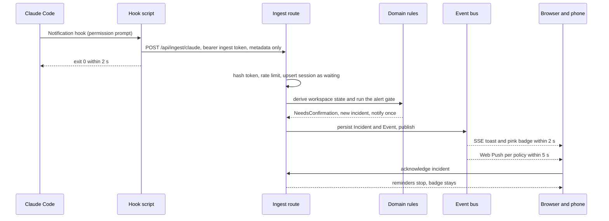
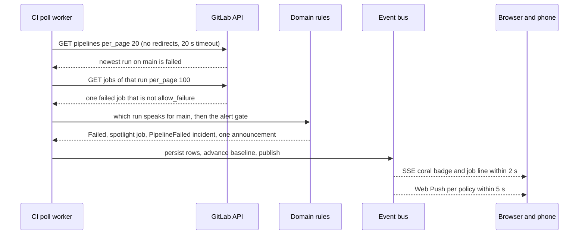
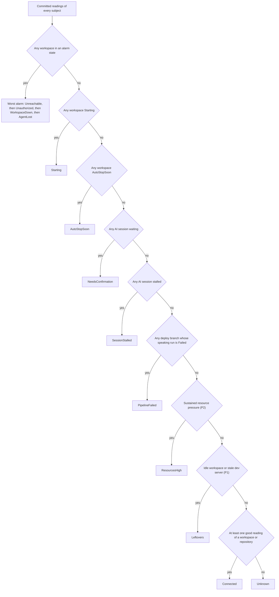
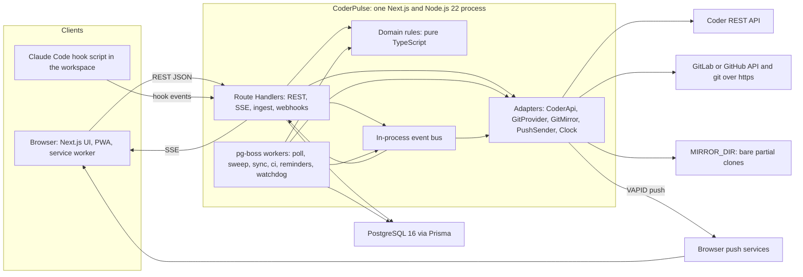
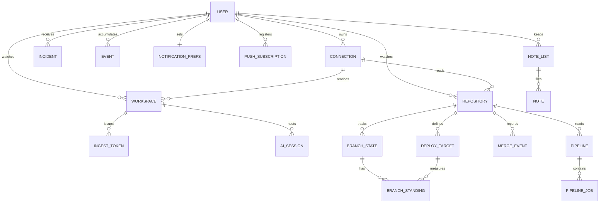

# CoderPulse — Product Requirements Document

|Field |Value|
|---|---|
|Product |CoderPulse (working name)|
|Version |1.0 (draft)|
|Date |2026-09-26|
|Owner |Phan Thanh Đức (ducpt@matbao.com)|
|Team |dev-mbc|
|Status |Draft for competition|
|Origin |Re-imagined from CoderMascot (internal Windows desktop tool)|

> **The heartbeat of your cloud workspace, your AI agents and your deploys — one tab, zero false alarms.**

## Executive summary

CoderPulse is a hosted web application that watches three things a cloud developer cannot see at once: the **Coder workspace** they work in, the **Claude Code sessions** running inside it, and the **deploy branches and CI pipelines** that carry their work to staging and production. It speaks up (tab title, toast, Web Push on a phone) the moment something needs a human, and stays quiet otherwise.

It is the web re-imagining of **CoderMascot**, an internal Windows tool a Mắt Bão developer built and uses daily. The competition version keeps the judgement that made the desktop tool trustworthy and changes the delivery: **web-based, multi-user, PostgreSQL-backed, one Next.js+Node.js project** (UI, REST API, real-time stream and background jobs in one codebase, package and Docker image). No mascot.

**Why it matters.** A workspace agent dies while Coder still reports "running"; a Claude Code session waits at a permission prompt unnoticed; "is my branch on production?" costs several git commands per branch; a red deploy pipeline is found when someone complains; naive monitors cry wolf until people mute them.

**What is different.** Seventeen **signal-integrity rules** (§3), taken from the desktop tool's code (most already pinned by its test suite) and ported as unit tests: agent state beats build state; alarms are debounced, recovery is instant; one change, one notification; a stalled monitor is a problem, not a green light; an unknown merge is "?", never "no"; a failed CI read is neither red nor green; acknowledging silences without hiding.

**Scope.** P0: GitLab sign-in, Coder and GitLab connections, workspace monitor and actions, Claude Code session watch, repositories with deploy targets, branch board, landing timeline, red-deploy detection, unified status with incidents and reminders, toast/SSE/Web Push with a policy and do-not-disturb, activity history, notes, and a demo mode with a scenario simulator. P1: leftovers and workspace ports, webhooks, squash-merge detection, encrypted secret notes, diagnostics, GitHub. P2: delivery insights, team spaces, chat channels, resource pressure, scale-out.

**Targets.** Agent drop→alarm ≈45 s; session waiting→push ≤5 s; zero false alarms from one failed poll; one notification per incident; coverage >70 %, 0 HIGH/CRITICAL vulnerabilities, p95 <500 ms, rollback <1 min.

---

## 1. What CoderPulse is

CoderPulse watches a developer's Coder cloud workspace **from outside it**, the Claude Code sessions inside it, which branches reached which environment, and CI pipelines, and it keeps notes. CoderMascot did this from a Windows desktop through an animated mascot and the tray. The twist: web-based, multi-user, database-backed; ONE project, a Next.js front end and a Node.js back end in one codebase, package and deployable; no mascot.

## 2. Problem, users and why web

**Primary persona: developer.** Works in a Coder cloud workspace (e.g. colab.matbao.ai, repositories on a self-hosted GitLab such as git.matbao.support), often runs several Claude Code sessions in parallel, ships through deploy branches (main→production, staging→staging, develop→development). **Secondary: tech lead.** Wants to know what reached production and whether a deploy branch is red (team features are P2).

|# |Pain |Today |CoderPulse|
|---|---|---|---|
|1 |Silent workspace death |Agent drops, Coder still says "running", dashboards stay green while every terminal and AI session is dead |Agent beats build: AgentLost in ≈45 s, pushed to the phone|
|2 |AI agents stuck waiting |A permission prompt or silent stall burns time; a finished agent goes unnoticed |Hook events: waiting→NeedsConfirmation in seconds; stalled after a threshold; finished announced once|
|3 |"Is my branch live?" |Several git commands per branch |One standing per deploy target plus a landing timeline|
|4 |Red deploy branches, unnoticed merges |Someone complains first |Failing job line on the badge; "deploy moved" announcements|
|5 |Alert fatigue |Monitors cry wolf on one blip or re-alert every poll; people mute them |Debounce, one-change-one-notification, back-off reminders, acknowledge|
|6 |Things left running |Idle workspaces and forgotten dev servers |Leftovers: lowest priority, never a reminder (P1)|

**Why web.** The monitor must never run inside the thing it watches: a hosted service is outside every workspace by construction and keeps watching while the laptop sleeps. Reach: desktop browser and phones via an installable PWA with Web Push. Memory: a database turns momentary signals into history (incident timeline, what landed when) and, later, delivery insights. Zero install, any OS (the desktop tool was Windows-only). Team-ready (P2).

## 3. Signal-integrity rules — the core differentiator

Each rule comes from the desktop tool's code; most are already pinned by its test suite, and every one is ported as a unit test (§6).

|# |Rule |Why it matters |How it is tested|
|---|---|---|---|
|1 |**Agent beats build.** A running build with a disconnected or timed-out agent is AgentLost, never Connected; agent state from `latest_build.resources[].agents[]` (`status`, `lifecycle_state`, `health.healthy`/`health.reason`) |Coder still says "running" |disconnected or timeout→AgentLost; only `connected`→Connected|
|2 |**Debounced alarms, instant recovery.** Alarms commit after `failuresBeforeAlarm` (2) consecutive alarm polls; two different alarms are one streak; Unauthorized commits on the first poll; recovery is never debounced; an unconfirmed alarm shows the last committed reading verbatim, never a hybrid |One blip must not page |[Unreachable, Unreachable] and [Unreachable, AgentLost]→commits on the 2nd; [Unreachable, Connected]→never commits; Unauthorized→commits on the 1st|
|3 |**Silent start.** The first reading after a monitor starts announces nothing unless it is an alarm or AutoStopSoon |Restarts must not re-announce |first Connected→silent; first AgentLost→notified|
|4 |**One change, one notification.** A same-state repoll refreshes the UI but never re-notifies |Re-alerting gets muted |identical readings→1 notification, 2 refreshes|
|5 |**A stalled monitor is a problem, not a green light.** A loop not completed within 3× its interval shows Unreachable, detail "Monitor stopped responding", never the last green reading |Dead pollers look healthy |fake Clock past 3×→Unreachable; stopped worker→watchdog|
|6 |**Unknown is never No.** A failed merge check yields Unknown ("?"), never "not merged" |"Not merged" triggers work |`--merged` fails→UNKNOWN for that target only|
|7 |**A failed read is neither red nor green.** A failed or unauthorized CI read never marks a deploy branch broken or passing |Expired tokens must not paint production |401/403/timeout→needs sign-in or problem; broken set unchanged|
|8 |**The worst run on the newest commit speaks for a branch.** A later green build cannot mask a red deploy run on the same push; a newer green commit clears an older red one |Deploy pipelines fail after builds pass |same sha [Passed,Failed]→Failed; newer Passed→clear|
|9 |**Only deploy branches can turn the status red.** Feature branches are their own business |Red feature branches are work |Failed on `feature/x`→no PipelineFailed|
|10 |**The first reading is a baseline.** A repository's first branch or CI reading announces nothing; a failed reading is not evidence of change; baselines advance only on good readings, so changes during a blip are announced afterwards |No storm on add, no missed merge |first sync silent; good, failed, good→announced after 2nd good|
|11 |**Only a deploy branch moving is news.** Feature-branch activity is silent |Feature pushes drown what matters |feature advances→silent; deploy branch→"deploy moved"|
|12 |**Acknowledging silences, it never hides.** Badge and history keep showing a live problem; a different state, or the same problem after a healthy interval, is a fresh incident with a full alert |"I know" is not "fixed" |ack→no reminders, badge unchanged; change or recurrence→new incident|
|13 |**Reminders back off.** Attention states only: first after `remindAfterSeconds` (120), gaps doubling to `remindMaxSeconds` (900): 2, 4, 8, 15, 15… min; the clock restarts when the state value changes |Persistent, not nagging |reminders at 120, 360, 840, 1740, 2640 s; value change restarts|
|14 |**Merges are ancestry, not names.** Merged=git ancestry; landing time only from first-parent merge commits on the target's own history; outbound merges excluded; an unrecognized subject yields no source branch. Recognized: `Merge branch 'x'[ into 'y']`, `Merge remote-tracking branch 'origin/x'`, `Merge pull request #N from owner/x` |Names lie, ancestry does not |parser table (3 forms, else null); first-parent only|
|15 |**Partial is not failed is not empty.** A sync is Done, Partial (footnote naming what could not be read) or Failed; one bad ref never blanks a repository |Blank boards destroy trust |one failing ref→Partial naming it, good branches present|
|16 |**Name the failure.** Connection tests classify: signed-in OK/sign-in needed/signed in but no access/unreachable/certificate untrusted, never a generic "failed" |Each needs a different fix |200, 401, 403, refused/timeout, TLS error→five classes|
|17 |**Clock skew is not idleness.** A future-dated `last_used_at` is ignored; brand-new dev servers are exempt from staleness |Skew must not stop work |future `last_used_at`→not idle; new dev server→not stale|

## 4. Scope and priorities

|Priority |Features|
|---|---|
|**P0** (MVP) |F1 Accounts & sign-in · F2 Connections & onboarding · F3 Workspace monitor · F4 Workspace actions · F5 AI agent session watch · F6 Repositories & deploy targets · F7 Branch board · F8 What landed, and when · F9 CI pipelines & red-deploy detection · F10 Unified status, incidents, reminders · F11 Notifications & policy · F12 Activity history · F13 Notes · F14 Demo mode & scenario simulator|
|**P1** (if time allows) |F15 Leftovers & workspace ports · F16 Instant updates via webhooks · F17 Squash-merge detection · F18 Secret notes (end-to-end encrypted) · F19 Repository diagnostics · GitHub as a full provider (sign-in, repositories, Actions); P0 is GitLab end-to-end|
|**P2** (vision) |F20 Delivery insights · F21 Team spaces/shared deploy board · F22 Chat & email channels · F23 Workspace resource pressure · F24 Horizontal scale-out|

## 5. Feature details

Quoted copy is draft wording for BA review.

### F1 Accounts & sign-in (P0)

**User story.** Sign in with my company GitLab account; nothing I add is visible to anyone else.

**Behaviour.** Auth.js v5 with the Prisma adapter; GitLab OAuth (base URL configurable, default `https://git.matbao.support`) in P0, GitHub in P1; a demo login only when `DEMO_MODE=true`. Database sessions (revocable); cookies `httpOnly`, `Secure`, `SameSite=Lax`. Every row scoped by `userId`, IDOR tests on every resource route. Account deletion wipes tokens, mirrors, notes and history; JSON export is P1.

**Acceptance.** User B with one of user A's ids on any resource route→`404 not_found` (**Assumption:** 404 rather than 403, so ids never confirm existence). `DEMO_MODE` unset→no demo provider, POST to it→404. Deleted session row→old cookie unauthenticated. `DELETE /api/account`→no row for that `userId`, mirror folder gone.

**Settings.** None.

### F2 Connections & onboarding (P0)

**User story.** Connect Coder and GitLab in minutes and always know whether each connection is healthy, and why not.

**Behaviour.** Coder: a bare host gets `https://`; https only (http for loopback in development); no `user:pass@`. "Open token page" opens `{url}/cli-auth` in a new tab; the token goes into a masked field. Connect validates before saving: `GET /api/v2/users/me` (401/403→"token rejected"; non-JSON 200=signed in, identity unknown), then `GET /api/v2/workspaces?q=owner:me` (one workspace auto-selects, several show a picker); nothing is saved unless validation passes. GitLab: reuse the sign-in OAuth grant when it carries `read_api`+`read_repository`, with server-side refresh; otherwise a personal access token with those scopes. GitHub (P1): a GitHub App with fine-grained read-only permissions. Tokens are encrypted at rest (AES-256-GCM, key id alongside for rotation), decrypted server-side at the moment of use, never sent to the browser, never logged; minimal read scopes, the only writes being workspace start/stop. "Test connection" returns OK/sign-in needed/signed in but no access/unreachable/certificate untrusted. A token failing with 401/403 flips the connection to "needs sign-in" and every dependent panel says so, never a silently empty panel. Onboarding wizard: sign in→connect Coder→pick workspace(s)→first repository→enable push→(optional) install session watch; steps skippable, progress remembered.

**Acceptance.** `colab.matbao.ai`→`https://colab.matbao.ai`; `http://coder.internal`→`validation_failed`; `https://me:pw@host`→refused; 401 on `/users/me`→"token rejected", nothing saved. A poll returning 403→`needs_sign_in` and every dependent panel reads "Sign in to {host}…". A canary token at `LOG_LEVEL=debug`→absent from logs, API bodies and bundle. Wizard closed at step 3→resumes there.

**Settings.** None.

### F3 Workspace monitor (P0)

**User story.** Learn within a minute that my workspace or its agent died, even while Coder says "running", and never be alarmed by a single blip.

**Behaviour.** Server-side, per watched workspace (several per user). Poll `GET {coder}/api/v2/users/{owner}/workspace/{name}` with header `Coder-Session-Token` every `pollSeconds` (20; hosted bounds 10–3600); timeout 10 s; redirects never followed. Classification, first match wins (this mirrors the desktop tool's classifier): configuration — URL or token missing or rejected→Unauthorized; network — timeout (10 s), DNS, TLS or connection failure→Unreachable; 401/403→Unauthorized; 404→WorkspaceDown ("no longer exists"); any other non-success status, redirects included (they are never followed)→Unreachable; a body that is not a recognisable workspace document (an SSO page, a proxy page, an error envelope)→Unreachable ("Coder returned an unexpected response."), never "workspace destroyed"; `latest_build.status` pending/starting→Starting, any other status except running→WorkspaceDown; running with no agent registered yet→Starting; agent `status` disconnected/timeout→AgentLost, connecting→Starting; `lifecycle_state` start_error/start_timeout→AgentLost, shutting_down/shutdown_timeout/shutdown_error/off→WorkspaceDown, any other value except ready→Starting; `health.healthy` false→AgentLost with `health.reason`; deadline within `autoStopWarnMinutes` (15; 1–1440)→AutoStopSoon; otherwise Connected. An unrecognised value therefore degrades to Starting, WorkspaceDown or Unreachable — never to Connected. Rules 1–5 apply (`failuresBeforeAlarm` 2; 1–10). Shown: build status, agent status, lifecycle, health reason, last used, auto-stop countdown. On the web, "Unreachable" means Coder cannot be reached from the CoderPulse server.

**Acceptance.** Defaults, agent disconnects at t0→poll 1 leaves the committed reading unchanged and shown verbatim, poll 2 commits AgentLost, one notification, alarm visible ≤45 s. Revoked token→the first 401 commits Unauthorized; one Unreachable poll then Connected→nothing commits or notifies. Poll job silent 60 s→Unreachable, "Monitor stopped responding". Same-state repoll with a new deadline→countdown updates, nothing notified. An SSO login page returned with HTTP 200→Unreachable "Coder returned an unexpected response.", never WorkspaceDown; `lifecycle_state` shutting_down→WorkspaceDown; start_error→AgentLost.

**Settings.** `pollSeconds` 20 (10–3600), `autoStopWarnMinutes` 15 (1–1440), `failuresBeforeAlarm` 2 (1–10).

### F4 Workspace actions (P0)

**User story.** Restart a dead workspace from my phone, warned about what I am about to kill.

**Behaviour.** Start/Stop/Restart via `POST {coder}/api/v2/workspaces/{id}/builds` with `{"transition":"start"|"stop"}`; the id is validated as a UUID first. Stop and Restart confirm: "Every terminal and AI session inside it will be killed." Restart is orchestrated server-side: stop→wait until stopped (polling, with a timeout)→start (the desktop fired both without waiting). **Assumption:** poll every 5 s, give up after 5 minutes with a "Restart timed out" event. 409→information "A build is already running"; 401/403→"Sign in to Coder again". Buttons are enabled only when the state allows the action (**Assumption:** Start when stopped or failed; Stop and Restart when running, including AgentLost; nothing while pending, starting or stopping). Every action is audit-logged.

**Acceptance.** Stop without `confirm: true`→`validation_failed`, no call to Coder; with it→transition posted, `AuditLog` row written. Restart→stop, wait until stopped, then start; badge Starting, then Connected. 409→"A build is already running"; 401→"Sign in to Coder again"; non-UUID id→refused before any network call.

**Settings.** None.

### F5 AI agent session watch — Claude Code (P0)

**User story.** Know within seconds when one of my Claude Code sessions waits for approval, stalls or finishes, with no prompt text leaving the workspace.

**Behaviour.** Push, not poll: a tiny hook script in the workspace sends Claude Code hook events to CoderPulse; it registers 8 hooks (SessionStart, UserPromptSubmit, PreToolUse, PostToolUse, Notification, Stop, SubagentStop, SessionEnd). Installer: a copy-paste snippet from the workspace page writes the script, registers the hooks in `~/.claude/settings.json` and embeds a per-workspace ingest token. Ingest: `POST /api/ingest/claude`, `Authorization: Bearer <ingest token>`; the token is write-only, scoped to one workspace, stored hashed, revocable, rotatable, rate-limited (**Assumption:** `cpw_`+32 random bytes base64url, shown once, SHA-256 at rest; 120 events/min per token). Payload `{sessionId, hook, toolName?, folder (basename of cwd), timestamp}`; prompt text and tool inputs/outputs never leave the workspace; unknown fields are dropped. The hook is fire-and-forget, 2 s timeout, always exits 0. Derived state per session: waiting (Notification hook, e.g. a permission prompt)/running a tool (PreToolUse without its PostToolUse)/thinking (after UserPromptSubmit or PostToolUse)/idle (Stop)/ended (SessionEnd). Stalled: running a tool with no event for `sessionStalledSeconds` (600; 60–86400), or thinking with no event for `sessionThinkingStalledSeconds` (180; 30–86400; clamped to the tool threshold). Workspace-level: any waiting→NeedsConfirmation, else any stalled→SessionStalled. Finished (`announceFinished`, on): edge-triggered busy→idle, one-shot, never changes the badge; the first reading after install or restart announces nothing; copy "Claude in {folder} finished — {duration}."/"Claude finished."/"{n} Claude sessions finished." In a workspace alarm state sessions show as unknown and raise no stall alerts; never received an event→install guidance. Per session: folder, live activity, idle age, run time, "Open workspace" link to `{coder}/@{owner}/{workspace}`.



**Acceptance.** Notification with a valid token→session waiting, workspace NeedsConfirmation, incident open, push out ≤5 s. Revoked token→401; rate limit→429 `rate_limited`; server unreachable→the hook still exits 0 within 2 s; extra fields such as `prompt`→discarded. PreToolUse then 600 s silence→stalled; UserPromptSubmit then 180 s→stalled; thinking threshold 900 with tool threshold 600→effective 600. Busy then Stop→exactly one finished notification, badge unchanged; a second Stop without busy between, or sessions already idle at first reading→nothing.

**Settings.** `sessionStalledSeconds` 600 (60–86400), `sessionThinkingStalledSeconds` 180 (30–86400,≤tool threshold), `announceFinished` on.

### F6 Repositories & deploy targets (P0)

**User story.** Add repositories and declare which branch deploys where, so every board and alert knows what "production" means for me.

**Behaviour.** Add from the provider's project list (with search) or by URL. Fields: name (defaults to the repo slug); group (free text, trimmed, ≤32 characters; spelling variants fold to the first-seen spelling); deploy targets (branch→environment; blank environment=branch name; duplicate branches refused; exactly one primary target, the one ahead/behind is measured against; a primary that no longer names a target falls back to the first); CI kind (Auto/Off/GitLab/GitHub; Auto=github.com→GitHub, else GitLab); optional CI URL (https only) and CI project path (≥2 segments of `[A-Za-z0-9._-]`, no `.` or `..` segment). Environment suggestions: main/master/prod/live→production; staging/stage→staging; develop/dev→development; uat/qa/test→themselves. URL rules: accept `https://`, `ssh://` and scp-style `git@host:path` (converted to the provider's https URL); `http://` only for loopback in development; refuse `::` transport syntax (e.g. `ext::`), a leading `-`, local/Windows/UNC paths, spaces or control characters, `git://`; an embedded password is stripped and the user told; a password inside scp-style syntax is refused outright. De-duplicate by provider+project path, case-insensitively. Save is blocked only by what the form can verify itself (blank path, malformed URL); a failed network check is a warning. Groups: a label on repositories, no empty groups, no dangling references; the left rail shows groups in first-appearance order plus one ungrouped band; every repository appears exactly once; fold state remembered per user.

**Acceptance.** `git@git.matbao.support:mbc/app.git`→`projectPath` `mbc/app`, fetch URL `https://git.matbao.support/mbc/app.git`; `https://u:pw@host/x.git`→saved without the password, user told; `ext::…`, `-flag`, `C:\repo`, `git://host/x`→refused, naming the rule. `main` twice→second refused; primary removed→first remaining target is primary; existing `MBC/App` plus new `mbc/app`→`conflict`; provider unreachable during Add→saved with a warning. Groups `Web`, `web ` and none→one group `Web` (2) plus the ungrouped band.

**Settings.** None.

### F7 Branch board (P0)

**User story.** One board shows, per branch, whether it is on staging and production, how far it is from the primary target, and which branches are done.

**Behaviour.** Each watched repository gets a server-side bare partial clone (`blob:none`) per user connection, remote named `origin` (not `--mirror`) so refs land under `refs/remotes/origin/*`; refreshed every `autoFetchMinutes` (10; 0=off; 1–1440), on "Sync now", and by webhook (P1). Readiness guard: readable only after one successful fetch (a marker written only on success, cleared if the copy proves unusable); a first fetch is allowed as soon as the bare repository exists. Cost, fixed regardless of branch count: `for-each-ref` with ahead-behind against the primary (git ≥2.41), `branch -r --merged <target>` per target, `log --first-parent --merges --max-count=400 --since=365.days` per target. Per branch: name, last commit (sha, time, author, subject), ahead/behind vs the primary, one standing per deploy target (`✓ staging · 2d`/`— production · not yet`/`? unknown`), and a group. Groups (fixed priority): Deploy (is a deploy branch)>Unknown (any standing unknown)>Shipped (merged into every target)>Partly (some)>Open (none); Shipped branches carry a "cleanup candidate" tag, never "safe to delete" (it affects the whole team). Sort: Recent/Name/Furthest behind/Author, unknown ahead/behind last. Filter matches name+author+subject. Summary chips are one-click filters ("12 not shipped"). For a row's headline colour, an unknown standing outranks "partly shipped". Trace: selecting a branch narrows the landing timeline (F8) to it. Squash merges read as "not merged" unless F17 is on. States: loading; never synced ("First sync in progress…"); partial (footnote naming what could not be read); failed (classified error plus the last good reading and its age); needs sign-in. Mirrors live under `MIRROR_DIR` in per-user 0700 folders with a size cap and cleanup on removal (**Assumption:** 2 GB per user, least-recently-synced evicted first).

**Acceptance.** Before the first successful fetch→"First sync in progress…", no git read. 300 branches, 2 targets→exactly 1 `for-each-ref`, 2 `branch -r --merged`, 2 `log` per read. Merged into `staging` only→Partly; `--merged origin/main` fails→Unknown group, `? unknown` for production only; merged everywhere→Shipped with "cleanup candidate". A fetch failing after a good one→classified error plus the last good reading and its age.

**Settings.** `autoFetchMinutes` 10 (0=off, else 1–1440).

### F8 What landed, and when (P0)

**User story.** See, per environment, what merged when, and trace one branch to the moment it landed.

**Behaviour.** Per deploy target, a day-grouped timeline of merges landing: first-parent merge commits with time, source branch (if recognized), author, subject, sha; window 365 days/400 merges; entries fade with age; trace filter from F7. Deployed strip above the board: one card per deploy target with environment, branch, last landing (else last commit), current pipeline label. Merge events are persisted (they feed history and the P2 insights).

**Acceptance.** `main`→only first-parent merges of `origin/main`, grouped by day, newest first, source branch parsed from recognized subjects and empty otherwise; a merge of `main` into `feature/x` (outbound)→absent under production. Branch selected on the board→only its landing entries; a target with no merge in 365 days→card shows the last commit. A newly discovered merge on a deploy branch→one `MergeEvent` row (unique by repository+sha).

**Settings.** None.

### F9 CI pipelines & red-deploy detection (P0 for GitLab, P1 for GitHub)

**User story.** Production turns red the moment its pipeline fails, with the failing job named, and never because a token expired.

**Behaviour.** GitLab: `GET {api}/api/v4/projects/{url-encoded path}/pipelines?per_page=20`; for the newest failed run only, `GET …/pipelines/{id}/jobs?per_page=100`. GitHub (P1): `GET {api}/repos/{owner}/{repo}/actions/runs?per_page=20`, jobs via `…/actions/runs/{id}/jobs`; GitHub Enterprise under `/api/v3`. Poll every `ciPollSeconds` (60; 0=off; 15–3600) or on webhook (P1); authenticated calls never follow redirects; timeout 20 s; numeric ids validated before they enter a path. 401/403→needs sign-in ("Sign in to {host} to read its pipelines."); any other failure→problem; neither is ever green or red. State mapping, worst-last: Unknown<Pending<Running<Waiting<Passed<Cancelled<Failed; Live=Pending or Running; Done=Passed, Failed or Cancelled.

|Source |Raw value→State|
|---|---|
|GitLab `status` |success→Passed; failed→Failed; running→Running; canceled/cancelled/skipped→Cancelled; manual→Waiting; created/pending/scheduled/preparing/waiting_for_resource→Pending|
|GitHub `status` completed, by `conclusion` |success/neutral→Passed; failure/timed_out/startup_failure→Failed; cancelled/skipped/stale→Cancelled; action_required→Waiting; other→Unknown|
|GitHub `status` otherwise |queued/pending/requested→Pending; in_progress→Running; waiting→Waiting|

Spotlight job=the first failed job that is not allow-failure. Job line: "stage › job on runner — reason (duration)", each part only when known. Duration: under 60 s "42s"; under 1 h "3m 05s"; else "1h 07m"; never less than 1 s. Label: live "● running · 3m 05s"; done "✓ passed · 5 min ago", "✗ failed · …", "⊘ cancelled · …". Broken deploy=a deploy branch whose speaking run (rule 8) is Failed→PipelineFailed; line per broken target "{environment} ({branch}) — {job line}". Finished pipelines since the last good reading are announced per `announcePipelines` all/failed/off (synonyms none/silent→off, failures/failure/fail→failed, unknown→all); a run counts as finished only if done now, not done (or unseen) last time, and finished after the last reading. Coalescing: several in one sweep→"{n} pipelines finished", body "1 failed · 2 passed" plus "app (main), api (develop)"; one run→"Pipeline failed|passed|cancelled", body "{repo} · {branch} — {commit title}" plus the job line. Pipelines pane (per repository; the desktop never got this UI): one row per branch, latest run first, with label, commit title, actor, CI link and spotlight job line; empty states "Pipelines are switched off for this repository."/"Sign in to {host} to read its pipelines."/"Pipeline polling is off — set the interval above zero to turn it on."/"No pipelines read yet." Deploy moved (`announceDeploys`, on): "{repo}: {environment} ({branch}) — {commit subject} by {author}", several joined with "; ".



**Acceptance.** Every raw value in the table→the listed state; unlisted→Unknown. `main` at one sha with [build Passed, deploy Failed]→PipelineFailed with line "production (main) — deploy › deploy-prod on runner-01 — script_failure (1m 12s)"; a Failed run on `feature/x` only→nothing. CI endpoint 401→"Sign in to {host} to read its pipelines.", badge unchanged. Durations 42, 185, 4020, 0 s→"42s", "3m 05s", "1h 07m", "1s". `announcePipelines=failed` with 1 failed+2 passed new runs→one "Pipeline failed"; `all`→one "3 pipelines finished", body "1 failed · 2 passed".

**Settings.** `ciPollSeconds` 60 (0=off, else 15–3600), `announcePipelines` all/failed/off, `announceDeploys` on.

### F10 Unified status, incidents, reminders (P0)

**User story.** One badge tells me whether anything needs me; saying "I know" stops the nagging without pretending the problem is gone.

|Code |Meaning |Class |Colour |Icon (lucide)|
|---|---|---|---|---|
|Unknown |nothing read yet |neutral |#64748B |circle-dashed|
|Connected |all clear |ok |#4ADE80 |circle-check|
|Starting |build or agent coming up |info |#38BDF8 |loader-circle|
|AutoStopSoon |auto-stop imminent |attention |#FBBF24 |timer|
|Unreachable |Coder cannot be reached, or the monitor stalled |alarm |#FB7185 |wifi-off|
|Unauthorized |Coder token missing, expired or rejected |alarm |#A78BFA |key-round|
|AgentLost |workspace up, agent dropped |alarm |#F87171 |unplug|
|WorkspaceDown |stopped, failed, shutting down, or not found |alarm |#F87171 |power-off|
|NeedsConfirmation |an AI session is waiting for you |attention |#F472B6 |hand|
|SessionStalled |an AI session has stalled |attention |#FB923C |hourglass|
|PipelineFailed |a deploy branch's pipeline is red |attention |#F97362 |circle-x|
|Leftovers (P1) |idle workspace or stale dev servers |info |#2DD4BF |leaf|
|ResourcesHigh (P2) |workspace under sustained pressure |attention |#FACC15 |gauge|

**Behaviour.** Colour is never the only signal: every state has an icon and a text label. Precedence, first match wins: a workspace alarm (across workspaces Unreachable>Unauthorized>WorkspaceDown>AgentLost)→Starting→AutoStopSoon→NeedsConfirmation→SessionStalled→PipelineFailed→ResourcesHigh→Leftovers→Connected→Unknown; PipelineFailed, ResourcesHigh and Leftovers only ever displace good news (Connected/Unknown). Connected means at least one subject (a workspace or a repository) has a good reading and nothing above applies — so a user who watches only repositories still gets an all-clear; Unknown means nothing has been read yet. The badge names its subject, e.g. "Agent lost — ducpt/dev". Global indicators: header badge, tab-title prefix, favicon dot in the state colour. Incidents open when a subject enters an attention or alarm state and close when it leaves; Acknowledge silences further notifications and reminders for that incident only (rule 12). Reminders (rule 13): attention and alarm states only, never Leftovers; copy "{Title} — still waiting" (under 1 min)/"{Title} — waiting {n} min"; recorded in history (an improvement over the desktop).



**Acceptance.** A AgentLost and B Unreachable→badge "Unreachable — B"; a red deploy branch plus a workspace Starting→Starting. Entering an attention or alarm state→`Incident` opens, tab-title prefix and favicon dot take the colour; recovery→incident closes. Acknowledged incident→no further toast, push or reminder, badge and Activity still show it; a different state on the same subject→new incident with a full alert. Open AgentLost incident with defaults→reminders at 2, 6, 14, 29, 44 min, each written to Activity; Leftovers→never.

**Settings.** `remindAfterSeconds` 120 (0=off, else 15–86400), `remindMaxSeconds` 900 (≥ remindAfterSeconds).

### F11 Notifications & policy (P0)

**User story.** Decide how loud CoderPulse is (everywhere, quietly, or not at all) and mute it for an hour without losing the record.

**Behaviour.** Channels: in-app toast (over SSE); notification centre (Activity, unread count); Web Push (service worker, installable PWA; works with the tab closed and on phones; iOS needs the home-screen app). Policy per user, unknown value→All:

|Policy |Toast |Web Push |Reminders |In-app banner+tab indicator |Badge & history|
|---|---|---|---|---|---|
|All |✓ |✓ |✓ |✓ |✓|
|Quiet |– |– |– |✓ |✓|
|Off |– |– |– |– |✓|
|Acknowledged incident (any policy) |– |– |– |– |✓|

Do not disturb: a manual toggle with auto-expiry (30 min/1 h/until tomorrow) plus an optional quiet-hours schedule; it suppresses reminders and one-shot announcements (session finished, deploy moved, pipeline finished); alarms still notify unless the policy is Off (an explicit decision). Announce toggles: `announceFinished` (on), `announcePipelines` (all), `announceDeploys` (on). Devices: list, test push, remove; dead subscriptions (HTTP 404/410) pruned automatically. Latency: SSE under 2 s, push under 5 s; payloads carry title, body, state and a deep link, never prompt text.

**Acceptance.** Each policy row×each channel, alarm commits→exactly the ticked channels fire (matrix test). All with DND active: session finishes or deploy moves→nothing toasted or pushed, event still written; AgentLost commits→toast and push still fire. Push endpoint answers 410→subscription deleted. Committed state change→SSE ≤2 s, push ≤5 s (e2e against the fake push sender).

**Settings.** `notifications` all/quiet/off, DND and quiet hours, the three announce toggles.

### F12 Activity history (P0)

**User story.** Scroll back through what happened while I was away, each entry coloured by how serious it really was.

**Behaviour.** A persisted event log per user: committed state changes, incidents opened/acknowledged/closed, reminders, session finished, deploy moved, pipeline finished, workspace actions, connection changes. Each event carries its own kind and severity (the desktop painted every one-shot event green; don't). Filters by kind, subject and severity; unread markers; retention 90 days (configurable). Never stores prompt text, folder names only.

**Acceptance.** Each producer fires once→exactly one `Event` per occurrence with the right kind, severity and subject; "pipeline failed" is attention, "session finished" info. Filter kind=incident, severity=alarm→only matching rows, cursor-paginated (**Assumption:** 50 per page); `POST /api/events/read`→unread count 0; the daily job deletes events older than 90 days.

**Settings.** Retention 90 days (server-side).

### F13 Notes (P0)

**User story.** Keep short notes next to my monitors and pin the important one to the Overview.

**Behaviour.** A note is free text filed in exactly one list (default list "General"), on one of 6 papers: yellow (default, #FDE68A), pink #FBCFE8, blue #BFDBFE, green #BBF7D0, purple #DDD6FE, grey #E5E7EB; an unknown colour falls back to yellow; also pinned, done, created, updated. Order: unfinished before done→pinned before unpinned→most recently updated. Lists: renaming onto an existing name is refused (never merged); deleting a list moves its notes to the first remaining list; the last list cannot be deleted; the active list is remembered. A note emptied of text is removed when its editor closes, never while it is being edited. Search across text. Empty states: "Nothing noted yet."/"Nothing in {list} yet."/a query beats the list name ("Nothing matches "{query}"."). "Pin to Overview" shows the note on the home screen. Keyboard: N=new note,/= search.

**Acceptance.** Notes [done+pinned, open+unpinned older, open+pinned, open+unpinned newer]→order open+pinned, open+unpinned newer, open+unpinned older, done+pinned. "Deploys" renamed to existing "General"→`conflict`; "Deploys" (3 notes) deleted→its notes in "General"; the only list→delete refused. Text cleared→deleted only when the editor closes; colour `teal`→yellow; query `rollback` with no match in "Deploys"→"Nothing matches "rollback".".

**Settings.** None.

### F14 Demo mode & scenario simulator (P0)

P0 because the competition demo must not depend on live infrastructure.

**User story.** Trigger each incident on stage with one button and know exactly what the room will see.

**Behaviour.** `DEMO_MODE=true`: demo sign-in; seeded fixtures (a fake Coder deployment with 2 workspaces, 3 repositories with deploy branches, merges, pipelines, AI sessions, notes); integrations replaced by in-process fakes behind the same adapter interfaces as production. Scenario buttons: agent drops (first poll nothing, second AgentLost+push) · token revoked (instant Unauthorized) · auto-stop in 10 min · AI session waiting for approval (pink badge+push in seconds) · AI session stalled · AI session finished (one toast, badge unchanged) · pipeline fails on production (coral badge+job line) · merge reaches production (deploy moved, timeline entry, "✓ production · just now") · recover everything. A "fast-forward" control compresses reminder timers for the stage (**Assumption:** 60× on the Clock adapter, so the 2-minute reminder lands after 2 s). Demo mode cannot be switched on in production by accident: explicit env var, and a banner on every page while it is on.

**Acceptance.** `DEMO_MODE` unset→`/api/demo/*` 404, no demo provider, no fixtures; `true`→banner on every page, demo login works, fixtures exist on first start. Each button→the listed effect within one poll interval; "recover everything"→Connected, all incidents closed. Fast-forward on→the first reminder of an open incident recorded within 5 s. Playwright replays §13 against demo mode.

**Settings.** `DEMO_MODE` (server env only).

### F15 Leftovers & workspace ports (P1)

Idle workspace: running and now−`last_used_at`≥`workspaceIdleMinutes` (45; 0=off; 5–10080); a future-dated `last_used_at` is ignored; action Stop (with confirmation). Stale dev servers: from Coder's agent listening-ports API (`GET /api/v2/workspaceagents/{agent}/listening-ports`; **Assumption:** verify on the target Coder version, degrade gracefully when absent); a port is a dev server if its process is a known runtime (node, python*, dotnet, java, go, vite, next… about 30 names) and the port is ≥1024; stale once first seen≥`devServerIdleMinutes` (120; 0=off; 5–10080) ago, the server recording first-seen; action Open (Coder port-forward URL, given a wildcard access URL); no remote kill. Swept every 60 s; lowest-priority, non-alarm, never a reminder. Ports tab: all listening ports; below 1024 hidden unless "System ports" is ticked; filter by port prefix or process substring; "yours" vs system styling. **Acceptance:** idle at the threshold→Leftovers; future `last_used_at`→not idle; `node` on 3000 first seen 121 min ago→stale, on 80→ignored; API absent→the tab says so, nothing else degrades.

### F16 Instant updates via webhooks (P1)

GitLab (`X-Gitlab-Token`) and GitHub (`X-Hub-Signature-256` HMAC, constant-time compare) for push, merge-request and pipeline events→targeted sync/CI read; polling remains the fallback. One-click registration where the user has permission, instructions otherwise. Per-repository webhook secrets, encrypted at rest. **Acceptance:** bad signature→401, no work queued; valid push→`repo.sync` for that repository only within 5 s.

### F17 Squash-merge detection (P1)

Cross-check merged MRs (GitLab `merge_requests?state=merged&target_branch=`) and PRs (GitHub `pulls?state=closed&base=`, `merged_at` set) and mark the standing "✓ (squash)", with `merged_at` as the landing time. **Acceptance:** absent from ancestry but with a merged MR onto the target→SQUASH; ancestry wins when both apply.

### F18 Secret notes — end-to-end encrypted (P1)

Encrypted in the browser with a key derived from a user passphrase (WebCrypto; PBKDF2-SHA-256 with at least 600,000 iterations, or Argon2id; AES-256-GCM with a random 96-bit IV per save); the server stores only ciphertext, IV, key version and a verifier; forgetting the passphrase loses the secret notes, warned explicitly. Rules (from the desktop tool's secret-notes tests): marking a note secret without an unlocked key fails loudly, never a silent fallback to plaintext; a secret note's plaintext never reaches the server; other notes are unaffected; a secret note that cannot be decrypted here shows as "Locked" and is preserved byte-for-byte (never blanked, never pruned); a secret note cannot be pinned to the Overview, and data claiming both is not honoured; the key lives in memory only and auto-locks after inactivity (**Assumption:** 15 minutes). **Acceptance:** each rule is a unit test on the client notes module, plus an API test proving `text` is null whenever `isSecret` is true.

### F19 Repository diagnostics (P1)

Per repository, the last 60 git/API operations with exit status, duration and redacted output ("Show what git said"), downloadable. Credentials are redacted (`user:secret@host`, known token patterns). **Acceptance:** stderr echoing the fetch URL with credentials is stored as `user:***@host`.

### P2 — vision

- **F20 Delivery insights** (DORA-style): deploy frequency per environment, lead time merge→production, change failure rate (red runs on deploy branches), time to restore (red→green), from persisted merge and pipeline history.
- **F21 Team spaces/shared deploy board.** Access is still verified per member with that member's own token.
- **F22 Chat & email channels:** Slack, Telegram, Google Chat, email digest.
- **F23 Workspace resource pressure:** CPU and memory from inside the workspace (agent metadata or a reporter); warn at `cpuWarnPercent`/`memoryWarnPercent` (88; 40–99) only after `loadSustainSeconds` (120) continuously; clear only 8 points below the threshold (hysteresis).
- **F24 Horizontal scale-out:** multiple app instances, Postgres LISTEN/NOTIFY fan-out for SSE.

## 6. Architecture decisions

|Decision |Choice |Why|
|---|---|---|
|Project shape |**One Next.js project** (App Router, TypeScript strict) on Node.js 22 LTS: UI, API and jobs |One codebase, package, image, deploy|
|Front end |React Server Components for reads, client components for live parts; Tailwind CSS+shadcn/ui (Radix); dark-first theme on the status palette |Fast first paint, accessible primitives|
|Back end |Route Handlers under `src/app/api/**` (`runtime='nodejs'`), JSON REST validated with Zod; `src/server/**` is `server-only` |Explicit server boundary, shared types|
|Background jobs |Same Node process, started from `instrumentation.ts` `register()`; **pg-boss** for singleton jobs, cron, retries |Postgres-backed queue, no Redis|
|Alternative |If an explicit Node server framework is required, mount the same `src/server` modules under a **Fastify** custom server |No domain code changes|
|Database |PostgreSQL 16+Prisma ORM, migrations checked in |The only infrastructure dependency|
|Real-time |SSE at `GET /api/stream` (per user, heartbeat 25 s, resume via `Last-Event-ID`) fed by an in-process event bus; multi-instance fan-out is P2 (F24). **Assumption:** replay buffer of the last 200 events per user |Proxy-friendly, no socket server|
|Web Push |`web-push` with VAPID keys; service worker `public/sw.js`; PWA manifest |Works with the tab closed, on phones|
|Git |System git ≥2.41; `execFile` with argv, never a shell; `--` before user values; ref names validated; `GIT_TERMINAL_PROMPT=0`; credentials per invocation via an askpass helper reading the child's environment, never argv or `.git/config`; https-only allow-list; mirrors under `MIRROR_DIR` (named volume), per-user 0700 folders, size cap, cleanup on removal |Ancestry needs real git; hardening makes user URLs safe|
|Domain rules |Pure TypeScript (classification, precedence, alert gate, reminders, standings, speaking run, finished-diff, notes): no I/O, fully unit-tested; the desktop tool's assertions are the acceptance spec |The rules are the product|
|Adapters |CoderApi, GitProvider, GitMirror, PushSender, Clock |Demo mode and tests swap in fakes|
|Observability |pino logs with redaction; a job-heartbeat table; `/api/health` (liveness), `/api/ready` (database+jobs) |Rule 5 needs heartbeats|
|Deployment |Standalone Next.js output in one Docker image (Node 22+git); docker-compose with Postgres and named volumes (database, mirrors), no host bind mounts; **deployed outside any workspace it monitors**; single replica |Never inside the watched thing|
|i18n |next-intl, English and Vietnamese from day one; every user-facing string is a key; PRD copy is a draft for BA wording review (**Assumption:** default locale follows the browser, English fallback, pending §16) |Wording is BA's call|

**Narrative.** Route Handlers validate with Zod, read through user-scoped accessors and call pure domain functions; pg-boss workers call adapters, hand raw results to the domain (classify, gate, diff against the baseline), persist and publish to the bus, which fans out to SSE and push. The Claude Code hook is the one inbound push path. Every dependency sits behind an adapter, so `DEMO_MODE` swaps in fakes driven by the scenario panel: the judges see the production code path.



**Suggested layout**

```
coderpulse/
  package.json                 UI+API+jobs in one project
  next.config.ts               output: 'standalone'
  instrumentation.ts           starts the job workers
  prisma/schema.prisma
  src/app/(public)/…           landing, sign-in
  src/app/(app)/…              overview, workspaces, repositories, activity, notes, settings, onboarding
  src/app/api/…                Route Handlers
  src/server/domain/           pure rules (unit-tested)
  src/server/integrations/     coder, gitlab, github, git-mirror, web-push
  src/server/jobs/             pg-boss workers
  src/server/security/         crypto, SSRF guard, redaction, rate limits
  src/server/db/               Prisma, scoped access
  src/lib/                     shared Zod schemas
  public/sw.js, public/manifest.webmanifest
  scripts/hooks/               session-watch hook script and installer template
  tests/unit, tests/integration, tests/e2e
  Dockerfile, docker-compose.yml, .env.example
```

**Environment variables.** `DATABASE_URL`, `AUTH_SECRET`, `APP_ENCRYPTION_KEYS` (versioned, base64 32-byte), `GITLAB_URL`, `GITLAB_CLIENT_ID`, `GITLAB_CLIENT_SECRET`, `GITHUB_APP_ID`/`GITHUB_APP_PRIVATE_KEY` (P1), `VAPID_PUBLIC_KEY`, `VAPID_PRIVATE_KEY`, `VAPID_SUBJECT`, `PUBLIC_BASE_URL`, `MIRROR_DIR`, `ALLOWED_PRIVATE_HOSTS`, `DEMO_MODE`, `LOG_LEVEL`.

|Job |Scope |Cadence|
|---|---|---|
|workspace.poll |per workspace |`pollSeconds` (20)|
|sessions.sweep |global |15 s|
|repo.sync |per repository |`autoFetchMinutes` (10), webhook, manual|
|ci.poll |per repository |`ciPollSeconds` (60), webhook|
|leftovers.sweep (P1) |per workspace |60 s|
|reminders.tick |global |15 s|
|watchdog |global |10 s (rule 5)|
|retention.cleanup, push.prune |global |daily|

Fan-out safety: bounded concurrency per host, jitter, per-connection backoff on 429/5xx, ETag conditional requests.

## 7. Data model



The diagram shows relationships; fields and constraints are in the table below.

|Entity |Key fields |Constraints and notes|
|---|---|---|
|User, Account, Session |Auth.js tables |Database sessions, revocable|
|Connection |kind CODER/GITLAB/GITHUB, baseUrl, tokenCiphertext, keyId, scopes, status, externalUsername |Token never leaves the server|
|Workspace |connectionId, coderWorkspaceId, owner, name, lastReading, committedState, alarmStreak |Unique (connectionId, coderWorkspaceId)|
|AiSession |workspaceId, externalId, status, toolName, folder, turnStartedAt, lastEventAt, endedAt |Folder basename only; pruned after 7 days|
|Repository |provider, host, projectPath, name, groupLabel, ciKind, ciUrl, ciProjectPath, webhookSecretCiphertext, syncStatus, lastGoodSyncAt, syncProblem |Unique (userId, provider, lower(projectPath))|
|DeployTarget |repositoryId, branch, environment, isPrimary, position |Unique (repositoryId, branch); exactly one primary when targets exist|
|BranchState, BranchStanding |name, sha, committedAt, author, subject, ahead, behind, branchGroup; deployTargetId, state YES/NO/UNKNOWN/SQUASH, landedAt |Replaced on each good read; one standing per branch×target|
|MergeEvent |repositoryId, targetBranch, sourceBranch, sha, mergedAt, author, subject |Unique (repositoryId, sha)|
|Pipeline, PipelineJob |externalId, branch, sha, state, rawStatus, title, workflow, actor, startedAt, finishedAt, durationSec, url; name, stage, state, runner, durationSec, failureReason, allowFailure, url |Unique (repositoryId, externalId); jobs for the newest failed run only|
|Incident |userId, subjectType, subjectId, state, openedAt, acknowledgedAt, closedAt, nextReminderAt, reminderCount |One open incident per subject|
|Event |userId, kind, severity, state, title, detail, subjectType, subjectId, occurredAt, readAt |Retention 90 days|
|NotificationPrefs |policy, announceFinished, announcePipelines, announceDeploys, remindAfterSeconds, remindMaxSeconds, dndUntil, quietHours |One per user|
|PushSubscription |endpoint, p256dh, auth, userAgent, lastSuccessAt, failureCount |Unique endpoint; pruned on 404/410|
|NoteList, Note |name, position; listId, text (nullable), isSecret, cipherText, iv, keyVersion, colour, pinned, done, pinnedToOverview |Unique list name per user; isSecret ⇒ text null, pinnedToOverview false|
|IngestToken, ListeningPort (P1), MonitorSettings, UserPrefs, SecretKeyMaterial (P1), AuditLog, JobHeartbeat |tokenHash, revokedAt; port, processName, firstSeenAt; per user/per workspace knobs; collapsedGroups, activeListId, theme, locale; kdf, salt, iterations, verifier; action, subject, ip, userAgent, at; job, lastRunAt, lastSuccessAt |Hash only; knobs clamped; never the key itself; heartbeats feed the watchdog|

## 8. API surface

User-scoped JSON. Error envelope `{ "error": { "code", "message", "details"? } }`; codes `validation_failed`, `not_found`, `sign_in_needed`, `forbidden`, `unreachable`, `certificate_untrusted`, `conflict`, `rate_limited`.

|Method |Path |Purpose|
|---|---|---|
|* |`/api/auth/*` |Auth.js|
|GET |`/api/me`; `/api/status`; `/api/stream` |User and prefs; badge, subject, reason, since; SSE|
|GET, POST; POST; PATCH, DELETE |`/api/connections`; `…/:id/test`; `…/:id` |List/create (validates first); classified test; update/remove|
|GET |`/api/coder/workspaces` |Discover `owner:me`|
|GET, POST; GET, PATCH, DELETE |`/api/workspaces`; `/api/workspaces/:id` |Watched list/watch; detail/knobs/unwatch|
|POST |`/api/workspaces/:id/check`; `…/actions` |Poll now; start, stop, restart (`confirm: true` for stop and restart)|
|GET; POST, DELETE; GET |`/api/workspaces/:id/sessions`; `…/ingest-token`; `…/session-watch/installer` |AI sessions; issue or rotate/revoke; installer snippet|
|POST |`/api/ingest/claude` |Hook ingest (ingest token)|
|GET |`/api/workspaces/:id/ports`, `/api/leftovers` |(P1) Ports, leftovers|
|GET |`/api/providers/:connectionId/projects?search=` |Project picker|
|GET, POST; GET, PATCH, DELETE |`/api/repositories`; `/api/repositories/:id` |List/add; detail/edit/remove|
|POST |`/api/repositories/:id/test`, `…/sync` |Access check, sync now|
|GET |`/api/repositories/:id/branches?sort=&q=&chip=`; `…/landed?target=&branch=`; `…/pipelines`; `…/diagnostics` (P1) |Branch board; landing timeline; pipelines pane; last 60 operations|
|POST |`/api/webhooks/gitlab/:repositoryId`, `/api/webhooks/github/:repositoryId` |(P1) Webhooks|
|GET; POST |`/api/incidents?open=true`; `/api/incidents/:id/acknowledge` |Incidents; acknowledge|
|GET; POST |`/api/events?cursor=&kind=&severity=`; `/api/events/read` |Activity; mark read|
|GET, PUT; PUT |`/api/preferences/notifications`; `/api/preferences/monitoring` |Policy, DND, toggles, reminders; knobs (clamped)|
|POST, DELETE; POST |`/api/push/subscriptions`; `/api/push/test` |Devices; test push|
|GET, POST; PATCH, DELETE |`/api/notes`; `/api/notes/:id`; `/api/note-lists`; `/api/note-lists/:id` |Notes; lists (delete moves notes)|
|GET, PUT |`/api/notes/key-material` |(P1) Secret-notes KDF parameters|
|GET; DELETE |`/api/account/export` (P1); `/api/account` |Export; wipe|
|POST |`/api/demo/scenarios/:name` |Demo mode only|
|GET |`/api/health`, `/api/ready` |Liveness; readiness|

## 9. Screens

Mockups with empty and error states are produced from this section before the build (Stitch, Claude Design, or the `/mockup` skill).

|# |Screen |Purpose |Layout and key components |Actions |States|
|---|---|---|---|---|---|
|1 |Landing+sign-in |Explain, sign in |Tagline, three pain/answer cards, "Sign in with GitLab" (demo login under `DEMO_MODE`) |Sign in |OAuth error named; demo banner|
|2 |Onboarding wizard |First success fast |Stepper: sign in→Coder→workspace(s)→first repository→push→(optional) session watch |Skip, back, test |Validating/failed (classified)/done; resumable|
|3 |**Overview ("Now")** |What needs you |Status hero (badge, subject, reason, since, Acknowledge); workspace cards; AI sessions card; deploy radar (every deploy target with its pipeline label); leftovers (P1); recent activity (last 12); pinned notes |Acknowledge, workspace actions, open incident |Skeletons; empty ("Connect Coder to start"); per-card needs sign-in; partial footnotes|
|4 |Workspace detail |Facts and control |Build/agent/lifecycle/health, last used, auto-stop countdown; actions; sessions; ports tab (P1); session-watch install |Start/Stop/Restart (confirm); install; rotate/revoke token |Loading; unreachable; needs sign-in; stalled monitor; no session yet→install guidance|
|5 |Repositories |Find one fast |Group rail (fold, counts, "!" on a broken deploy)+list; Add |Add, fold |Empty; never synced; failed with last good age; needs sign-in|
|6 |Repository detail |Branches, landings, pipelines |Header (sync status, Sync now, Edit); Deployed strip; Branches board/What landed/Pipelines; diagnostics drawer (P1) |Sync, sort, filter, chips, trace, open CI |Loading; "First sync in progress…"; partial footnote; failed+last good; F9 empty states; needs sign-in|
|7 |Repository editor |Targets and CI |Name, group (suggestions), deploy-targets table (environment suggestions, primary radio), CI kind/URL/project path |Save, test access, remove |Inline validation; non-blocking network warning; conflict|
|8 |Activity |What happened |Filters (kind, subject, severity); day-grouped list, severity colour+icon; unread markers |Mark all read, open subject |Empty; filtered-empty; loading|
|9 |Notes |Quick notes |Lists sidebar; paper-coloured card grid; search; secret lock (P1) |New (N), search (/), pin, done, move, pin to Overview |F13 empty states; Locked (P1)|
|10 |Settings |Every knob |Connections; Notifications (policy, DND, toggles, reminders, devices); Monitoring (knobs with bounds); Privacy & data (export, delete); About |Test connection, test push, remove device, delete account |Needs sign-in per connection; clamped-value notice|
|11 |Demo panel |Drive the demo |F14 buttons, fast-forward |Trigger, recover all |Demo mode only|

**Global.** Header badge; tab title+favicon indicator; toasts; command palette (Ctrl/Cmd+K); shortcuts `g o` overview, `g r` repositories, `n` new note, `/` search, `?` help. Responsive: the Overview must work at phone width (push→tap→the incident).

## 10. Non-functional requirements

|Area |Requirement|
|---|---|
|Security |Tokens encrypted at rest, never in the browser or logs; https-only outbound; authenticated requests never follow redirects; SSRF guard (resolve DNS; block private, link-local and metadata ranges unless in `ALLOWED_PRIVATE_HOSTS`); CSRF (SameSite+Origin check on mutations); strict CSP, HSTS, `frame-ancestors 'none'`; rate limits on sign-in, ingest, webhooks and connection tests (**Assumption:** 10/min per IP, 120/min per ingest token, 60/min per webhook, 10/min per user); constant-time secret comparisons; git hardening as in §6; audit log for connection, workspace-action, ingest-token and account events; `npm audit`+Trivy with 0 HIGH/CRITICAL|
|Privacy |Data minimization (no prompt text; folder basenames); retention (events 90 days, session events 7 days); export and delete; secret notes end-to-end (P1). Deploy inside the company network perimeter when monitoring company workspaces|
|Performance |API p95 <500 ms; Overview LCP <2.5 s; SSE <2 s; push <5 s|
|Scale (MVP, one instance) |**Assumption:** 200 users, 400 workspaces, 1,000 repositories|
|Reliability |Watchdog (rule 5); job retries with backoff; graceful degradation, one failing integration never blanks a page; restart-safe baselines (persisted)|
|Accessibility |WCAG 2.2 AA; never colour alone; full keyboard use; reduced motion respected|
|i18n |English+Vietnamese|
|Testing |Overall coverage ≥70 %, domain rules 100 %; integration tests against fakes (MSW); Playwright e2e of the demo script|
|Operability |Rollback in under 1 minute (previous image tag); backward-compatible migrations|

## 11. Success metrics

|Metric |Target|
|---|---|
|Agent drop→alarm |≤ pollSeconds×failuresBeforeAlarm+5 s (≈45 s with defaults)|
|AI session waiting→push |≤5 s after the hook fires|
|Deploy-branch pipeline fails→alert |≤ ciPollSeconds+10 s (≤10 s with webhooks)|
|Merge reaches a deploy branch→notification |≤ autoFetchMinutes (≤60 s with webhooks)|
|False alarms from a single failed poll |0 (by construction, tested)|
|Notifications per incident |Exactly 1, plus back-off reminders; 0 duplicates on a same-state repoll|
|Engineering |Coverage >70 %, 0 HIGH/CRITICAL vulnerabilities, p95 <500 ms, rollback <1 min|

## 12. Milestones

No dates. **Assumption:** 1–3 developers over about 2–3 weeks.

|Milestone |Scope |Exit criteria|
|---|---|---|
|**M0 Foundation** |Scaffold, schema, Auth, layout/theme, demo-mode skeleton, CI |`docker compose up` serves sign-in; migrations apply from empty; demo login works; CI runs lint, tests, `npm audit`|
|**M1 Workspace & status** |Coder connection+onboarding; workspace monitor with rules 1–5; actions; unified status, incidents, SSE, Web Push, policy, reminders; Activity |Rules 1–5, 12, 13 green; "agent drops" yields one push on a phone; restart flows Starting→Connected|
|**M2 Repositories & deploys** |Repositories and targets, mirror sync, branch board, landed timeline, CI pipelines, red-deploy detection, announcements |Rules 6–11, 14, 15 green; a real GitLab repository shows standings, landings, pipelines; a failed deploy run turns the badge coral|
|**M3 AI sessions, notes, polish** |Session watch (hooks+ingest), notes, demo scenarios, e2e of the demo script, hardening, docs |Installer works in a real workspace; every F14 button behaves as listed; Playwright replays §13; 0 HIGH/CRITICAL; coverage ≥70 %|
|**M4 (if time)** |P1 items |Each shipped P1 feature meets its acceptance line|

## 13. Demo script (5 minutes)

|Step |Presenter |Judges see|
|---|---|---|
|1 |Sign in (demo) |Overview all clear: green badge, two workspaces, three repositories|
|2 |"AI session waiting for approval" |Pink badge and toast; a push on the phone within seconds; Acknowledge stops reminders, badge stays pink|
|3 |"Agent drops" once, then again |First: nothing (explain the debounce). Second: red "Agent lost"+push while the fake Coder still says "running"|
|4 |Restart the workspace |Confirmation copy; Starting, then Connected; incident closed|
|5 |"Pipeline fails on production" |Coral "Pipeline failed" with the job line; the Pipelines pane shows the failing row|
|6 |"Merge reaches production" |"Deploy moved" notification; the What-landed timeline gains an entry; the board shows "✓ production · just now"|
|7 |Activity; (P1) unlock a secret note |Every step as a severity-marked event; a "Locked" note readable after the passphrase|

## 14. Risks & mitigations

|Risk |Mitigation|
|---|---|
|Coder API differences between versions |Capability detection, graceful degradation|
|GitLab/GitHub rate limits, fan-out across users |Bounded concurrency, jitter, ETag, webhooks|
|Holding many users' tokens |Envelope encryption, minimal scopes, no browser exposure, audit, key rotation|
|SSRF through user-supplied URLs |§10 guard|
|Mirror disk growth |`blob:none` partial clones, size cap, cleanup, LRU eviction|
|Being hosted inside the workspace it monitors |Deployment rule (§6)|
|Web Push limits on iOS |In-app fallback, home-screen install, P2 chat channels|
|AI-session privacy |Metadata only, retention|
|Squash merges |F17|
|GitLab OAuth access tokens expiring |Server-side refresh, clear "needs sign-in" state|

## 15. Out of scope

- The desktop mascot/character, its animations and speech bubbles.
- Windows-desktop-only features: tray icon, global hotkeys, start with Windows, focusing local windows, reading or closing processes and ports on the user's own PC, the user's own PC's CPU and memory.
- Any write action on repositories or CI (no merging, branch deletion or pipeline retry): read-only by design; pipeline retry could be a P2 idea.
- Running commands inside workspaces from the server.

## 16. Open questions (for the owner)

Competition rules (team size, duration, judging criteria, whether a live demo against real Coder/GitLab is expected); the final product name; the hosting target; the default UI language; who registers the GitLab OAuth application on the company GitLab; whether team features (P2) matter for judging.

## Appendices

### A. Settings reference

Out-of-range values are clamped server-side, never rejected silently; unknown enum words fall back to the documented default.

|Setting |Default |Bounds|
|---|---|---|
|pollSeconds |20 |10–3600|
|autoStopWarnMinutes |15 |1–1440|
|failuresBeforeAlarm |2 |1–10|
|sessionStalledSeconds |600 |60–86400|
|sessionThinkingStalledSeconds |180 |30–86400,≤sessionStalledSeconds|
|announceFinished |on |on, off|
|workspaceIdleMinutes (P1) |45 |0=off, else 5–10080|
|devServerIdleMinutes (P1) |120 |0=off, else 5–10080|
|autoFetchMinutes |10 |0=off, else 1–1440|
|ciPollSeconds |60 |0=off, else 15–3600|
|announcePipelines |all |all, failed, off|
|announceDeploys |on |on, off|
|notifications |all |all, quiet, off|
|remindAfterSeconds |120 |0=off, else 15–86400|
|remindMaxSeconds |900 |≥ remindAfterSeconds|
|cpuWarnPercent/memoryWarnPercent (P2) |88 |40–99|
|loadSustainSeconds (P2) |120 |0–86400|

### B. Glossary

|Term |Meaning|
|---|---|
|Coder workspace |A Coder-managed cloud development environment: a build plus one or more agents|
|Agent |The in-workspace process Coder talks to; its `status`, `lifecycle_state` and `health` decide usability|
|Deploy branch |A branch declared as a deploy target, the only kind that can turn the status red|
|Environment |Where a deploy branch goes (production, staging, development, …)|
|Primary target |The deploy target ahead/behind is measured against|
|Standing |A branch's relation to one deploy target: merged, not yet, unknown, squash (P1)|
|Landing |A first-parent merge commit on a deploy branch's own history|
|Spotlight job |The first failed, non-allow-failure job of a red pipeline|
|Incident |One subject's stay in one attention or alarm state: opened, optionally acknowledged, closed|
|Baseline |The last good reading a change is measured against|

### C. Lineage — CoderMascot to CoderPulse

|CoderMascot capability |CoderPulse |Disposition|
|---|---|---|
|Workspace watch |F3/F4 |Kept|
|Claude session watch |F5 |Redesigned for web: hooks push to an ingest endpoint instead of being polled over SSH|
|Branch & deploy tracking |F6–F8 |Redesigned for web: server-side mirror|
|CI pipelines |F9 |Kept, plus the pipelines pane the desktop never got|
|Alerts, reminders, acknowledgement |F10/F11 |Kept; delivery via Web Push instead of the tray|
|State history |F12 |Redesigned for web: persisted instead of in-memory|
|Notes |F13/F18 |Kept; secret notes finally shipped|
|Idle workspace & dev servers |F15 |Redesigned for web: workspace ports instead of the local PC|
|Local PC resources, ports, processes |— |Dropped (F23 moves the idea into the workspace)|
|Desktop mascot, tray, hotkeys, Windows startup |— |Dropped|
