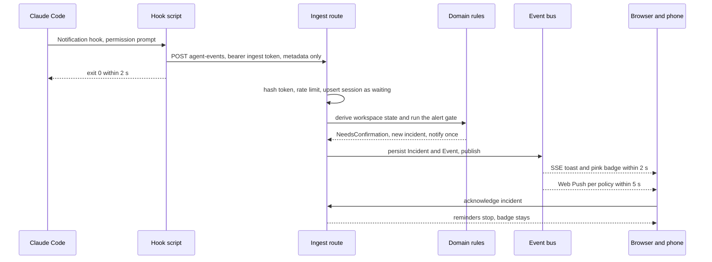
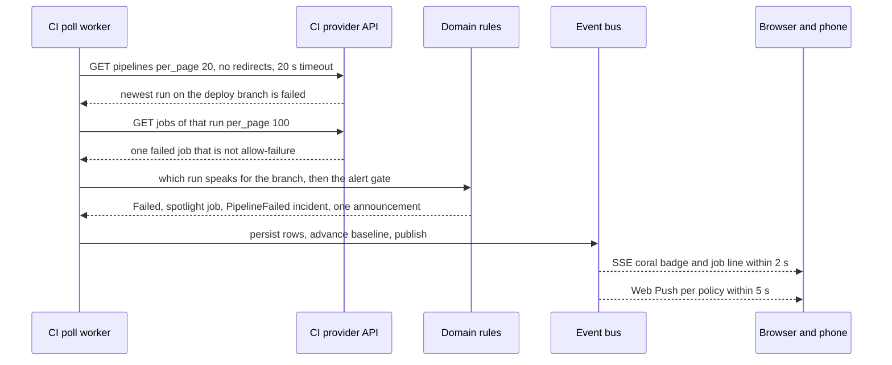
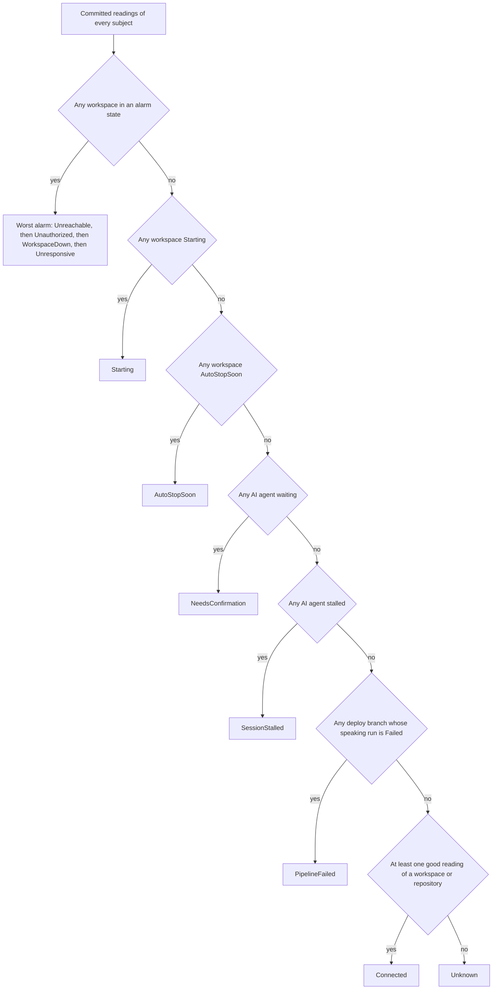
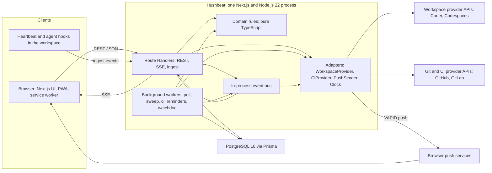
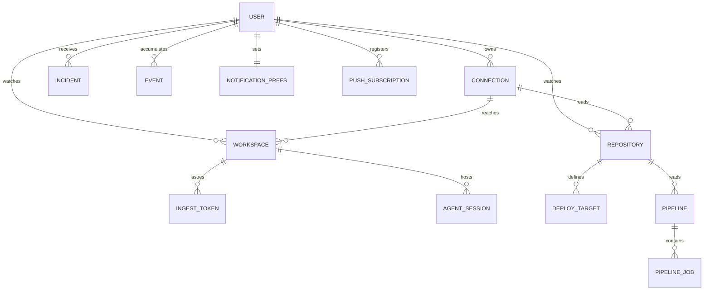

# Hushbeat — Product Requirements Document

|Field |Value|
|---|---|
|Product |Hushbeat|
|Version |2.0 (draft)|
|Date |2026-09-30|
|Author |Phan Thanh Đức|
|Status |Revised after the organiser's review|
|Build window |Tue 29/09/2026 → Wed 14/10/2026 (one developer)|

> The quiet heartbeat of your workspaces, your AI agents and your deploys — one tab, zero false alarms.

## Revision notes

The competition organiser asked for three changes. This revision addresses each:

- **Scope.** Narrowed to three core functions (§4.1). Everything that left P0 is listed with its new place (§4.3). Milestones are re-planned for the 15-day build window (§12).
- **No internal information.** Every host, organisation and person in an example is fictional (`example.com` hosts, an organisation called Acme). The demo runs on a built-in simulated environment, the Sandbox (S3). Only public products and fictional examples appear; no private systems are referenced.
- **Identity.** The product is renamed Hushbeat. It is provider-neutral by design and carries no employer branding.

Hushbeat is an independent project. Coder, GitHub, Codespaces, GitLab and Claude Code are trademarks of their respective owners; Hushbeat is not affiliated with or endorsed by them or by any employer.

## Executive summary

**What it is.** Hushbeat is a hosted web application that watches three things a developer cannot see at once: whether their workspace (Coder, GitHub Codespaces, or any Linux/macOS machine) is actually alive; whether their AI coding agents are waiting on them; and whether a deploy branch's pipeline is red. It speaks up once — tab title, toast, Web Push on a phone — and stays quiet otherwise. Web-based, multi-user, PostgreSQL-backed, one Next.js + Node.js project, provider-neutral throughout via adapters.

**Why it matters.**
- A workspace dies while its provider still says "running".
- An AI agent waits at a permission prompt, unnoticed.
- A red deploy pipeline is found only when someone complains. Native CI email notifications fire per run and per repository, and cannot tell a production branch from a feature branch.
- Naive monitors cry wolf until people mute them.

**What is different.** Fourteen signal-integrity rules (§3), each with its own unit test.

**Scope.** P0 is three core functions plus three supporting parts, named explicitly in §4.1–4.2.

**Targets.**
- Coder agent drop → alarm ≈45 s.
- Heartbeat silence → alarm ≤90 s.
- AI agent waiting → push ≤5 s.
- Deploy pipeline fails → alert ≤70 s.
- Zero false alarms from one failed poll.
- One notification per incident.
- Coverage >70 %, 0 HIGH/CRITICAL vulnerabilities, p95 <500 ms, rollback <1 min.

## 1. What Hushbeat is

Hushbeat watches a developer's workspace from outside it, the AI coding agents running inside it, and the CI pipelines that carry their work to staging and production. It is provider-neutral: workspace providers (Coder, GitHub Codespaces), a universal heartbeat for any Linux or macOS machine, AI coding agents (Claude Code first), and Git hosts with CI (GitHub, GitLab). Each is reached through an adapter, and the Sandbox swaps every adapter for a simulated one, so the demo and the tests exercise the same code path as production.

## 2. Problem, users and why web

**Primary persona: a developer.** Works in a cloud development environment (Coder, GitHub Codespaces) or on their own machine or VPS, with repositories on GitHub or GitLab, cloud or self-managed. Often runs several AI coding agent sessions in parallel and ships through deploy branches (`main`→production, `staging`→staging).

**Secondary persona: a tech lead.** Wants to know whether a deploy branch is red across a team's repositories (team features are P2).

|# |Pain |Today |Hushbeat|
|---|---|---|---|
|1 |Silent workspace death |A workspace's in-workspace agent drops, or a machine just stops beating, while the dashboard still says "running" |Inside beats outside: Unresponsive in ≈45–90 s, pushed to the phone|
|2 |AI agents stuck waiting |A permission prompt or a silent stall burns time; a finished agent goes unnoticed |Hook events: waiting→NeedsConfirmation in seconds; stalled after a threshold; finished announced once|
|3 |Red deploy branches unnoticed |Someone complains first; native CI notifications fire per run and per repository and cannot tell production from a feature branch |Failing job line on the badge, one alert per incident, only for deploy branches|
|4 |Alert fatigue |Monitors cry wolf on one blip or re-alert every poll; people mute them |Debounce, one-change-one-notification, back-off reminders, acknowledge|

**Why web.** The monitor must never run inside the thing it watches: a hosted service is outside every workspace by construction and keeps watching while the laptop sleeps. Reach: desktop browser and phones via an installable PWA with Web Push. Memory: a database turns momentary signals into history (incident timeline) and, later, delivery insights. Zero install, any OS. Self-hostable, so it can run inside your own network when it watches private systems. Team-ready (P2).

## 3. Signal-integrity rules — the core differentiator

These fourteen rules are Hushbeat's own design, drawn from day-to-day AI-assisted development in cloud workspaces. Each is specified as a unit test.

**Workspace liveness (F1)**

|# |Rule |Why it matters |How it is tested|
|---|---|---|---|
|1 |**Inside beats outside.** A workspace whose provider reports it running, but whose in-workspace agent (Coder) is disconnected/timed out, or whose heartbeat is silent, is Unresponsive, never Connected |A provider's status page can lag reality |Coder disconnected/timeout while running→Unresponsive; a Codespace `Available` with the heartbeat silent past its window→Unresponsive; connected agent or fresh beat only→Connected|
|2 |**Debounced alarms, instant recovery.** Alarms commit after `failuresBeforeAlarm` (2) consecutive alarm polls; two different alarms are one streak; Unauthorized commits on the first poll; recovery is never debounced; an unconfirmed alarm shows the last committed reading verbatim |One blip must not page |[Unreachable, Unreachable] and [Unreachable, Unresponsive]→commits on the 2nd; [Unreachable, Connected]→never commits; Unauthorized→commits on the 1st|
|3 |**Silent start.** The first reading after a monitor starts announces nothing unless it is an alarm or AutoStopSoon. After Hushbeat's own restart, heartbeat silence is measured from the later of the last beat and the restart, so our outage never reads as the user's |Restarts must not re-announce; our outage must not become their alarm |first Connected→silent; first Unresponsive→notified; restarted 30 s ago, last beat 5 min ago→no alarm until a full silence window has passed since restart|
|4 |**One change, one notification.** A same-state repoll refreshes the UI but never re-notifies |Re-alerting gets muted |identical readings→1 notification, 2 refreshes|
|5 |**A stalled monitor is a problem, not a green light.** A loop not completed within 3× its interval shows Unreachable, "Monitor stopped responding", never the last green reading |Dead pollers look healthy |fake Clock past 3×→Unreachable; stopped worker→watchdog|

**AI agent watch (F2)**

|# |Rule |Why it matters |How it is tested|
|---|---|---|---|
|6 |**Finished is news once.** Announced once, on the busy→idle edge; never changes the badge; the first reading after install or restart announces nothing |One word, not a running commentary |busy then Stop→exactly one notification; a second Stop with no busy between→nothing; idle at first reading→nothing|
|7 |**A dead workspace raises no stall alarms.** While its workspace is in an alarm state, a session shows as unknown and raises no stall alerts |One incident, not one per agent inside it |workspace Unresponsive + tool running 20 min→no SessionStalled|

**Deploy pipeline guard (F3)**

|# |Rule |Why it matters |How it is tested|
|---|---|---|---|
|8 |**A failed read is neither red nor green.** A failed or unauthorized CI read never marks a deploy branch broken or passing |Expired tokens must not paint production |401/403/timeout→needs sign-in or problem; broken set unchanged|
|9 |**The worst run on the newest commit speaks for a branch.** A later green build cannot mask a red deploy run on the same push; a newer green commit clears an older red one |Deploy pipelines fail after builds pass |same sha [Passed, Failed]→Failed; newer Passed→clear|
|10 |**Only deploy branches can turn the status red.** Feature branches are their own business |Red feature branches are work, not an incident |Failed on `feature/x`→no PipelineFailed|
|11 |**The first reading is a baseline.** A repository's first CI reading announces nothing; a failed reading is not evidence of change; baselines advance only on good readings |No storm on first add |first read silent; good, failed, good→announced after the 2nd good|

**Alert engine (S2)**

|# |Rule |Why it matters |How it is tested|
|---|---|---|---|
|12 |**Acknowledging silences, it never hides.** Badge and history keep showing a live problem; a different state, or the same problem recurring after a healthy interval, is a fresh incident with a full alert |"I know" is not "fixed" |ack→no reminders, badge unchanged; change or recurrence→new incident|
|13 |**Reminders back off.** Attention/alarm states only: first after `remindAfterSeconds` (120), gaps doubling to `remindMaxSeconds` (900): 2, 4, 8, 15, 15… min; the clock restarts on a state change |Persistent, not nagging |reminders at 120, 360, 840, 1740, 2640 s; value change restarts|
|14 |**Name the failure.** Connection tests classify: signed-in OK/sign-in needed/signed in but no access/unreachable/certificate untrusted, never a generic "failed" |Each needs a different fix |200, 401, 403, refused/timeout, TLS error→five classes|

These rules move with their P1 features:
- "unknown is never no", "only a deploy branch moving is news", "merges are ancestry" and "partial is not failed is not empty" (branch board);
- "clock skew is not idleness" (leftovers).

## 4. Scope and priorities

### 4.1 Three core functions (P0)

|# |Function |Tells you|
|---|---|---|
|F1 |Workspace liveness |Your workspace is dead or frozen, even while its provider says "running"|
|F2 |AI agent watch |A coding agent is waiting for approval, has stalled, or has finished|
|F3 |Deploy pipeline guard |A deploy branch's pipeline is red, with the failing job named, and never because a token expired|

### 4.2 Supporting parts (not functions, kept to the minimum the functions need)

- **S1 Sign-in & connections**
- **S2 Alert engine**: unified status, incidents, reminders, notifications, incident log
- **S3 Sandbox**: simulated environment for the demo and tests

### 4.3 What left P0

|Item |New place |Why|
|---|---|---|
|Branch board and "what landed" timeline |P1 |Both need a server-side git mirror, the costliest and riskiest part: git in the image, disk, a credential helper, user-supplied git URLs|
|Workspace actions (start/stop/restart) |P1 |Write access plus orchestration; watching is the product|
|Notes |Out of scope |Unrelated to monitoring|
|Full activity history (filters, unread markers, retention settings) |P1 |P0 keeps a plain incident log|
|Do-not-disturb, quiet hours, announce toggles |P1 |P0 keeps the All/Quiet/Off policy plus acknowledge|
|Onboarding wizard, repository groups, per-user tuning of timing settings |P1 |P0 has one Connect page, a copy-paste installer and server defaults|
|Git URL entry |Gone |Repositories are picked from the provider's list|
|Demo mode |Stays, renamed the Sandbox (S3) |It is a harness, not a function|

### 4.4 Roadmap after the MVP

- **P1:** branch board & landing timeline (git mirror) · workspace actions · webhooks for instant CI updates · full activity history · do-not-disturb schedules & announce toggles · onboarding wizard · per-user settings · more AI agents with hook or notify callbacks (e.g. Codex CLI) · leftovers & workspace ports · squash-merge detection · repository diagnostics · account export.
- **P2:** delivery insights (DORA-style) · team spaces · chat & email channels · more workspace providers (Gitpod/Ona, DevPod, Daytona) · more Git/CI providers (Bitbucket, Azure DevOps, Gitea/Forgejo, Jenkins) · workspace resource pressure · horizontal scale-out.

### 4.5 Supported in P0

|Area |Providers|
|---|---|
|Workspaces |Coder (API: agent, lifecycle, auto-stop); GitHub Codespaces (API: state, idle timeout); any Linux/macOS machine or container via the heartbeat|
|AI agents |Claude Code (hooks)|
|Git & CI |GitHub (github.com, GitHub Enterprise Server) and GitLab (gitlab.com, self-managed), on equal footing|

## 5. Feature details

Quoted copy is draft wording, reviewed before release.

### F1 Workspace liveness (P0)

**User story.** Learn within a minute or two that my workspace died or froze, even while its provider says "running", and never be alarmed by a single blip.

**Behaviour, in these parts:**

**(a) Sources.** A watched workspace has a provider link (Coder or Codespaces), a heartbeat, or both. Several workspaces per user.

**(b) Coder.** Poll `GET {coder}/api/v2/users/{owner}/workspace/{name}` with header `Coder-Session-Token` every `pollSeconds` (20); timeout 10 s; redirects never followed. Classification, first match wins: configuration — URL or token missing or rejected→Unauthorized; network — timeout, DNS, TLS or connection failure→Unreachable; 401/403→Unauthorized; 404→WorkspaceDown ("no longer exists"); any other non-success status, redirects included→Unreachable; a body that is not a recognisable workspace document (an SSO page, a proxy page, an error envelope)→Unreachable ("Coder returned an unexpected response."), never "workspace destroyed"; `latest_build.status` pending/starting→Starting, any other status except running→WorkspaceDown; running with no agent registered yet→Starting; agent `status` disconnected/timeout→Unresponsive, connecting→Starting; `lifecycle_state` start_error/start_timeout→Unresponsive, shutting_down/shutdown_timeout/shutdown_error/off→WorkspaceDown, any other value except ready→Starting; `health.healthy` false→Unresponsive with `health.reason`; deadline within `autoStopWarnMinutes` (15)→AutoStopSoon; otherwise Connected. An unrecognised value degrades to Starting, WorkspaceDown or Unreachable — never to Connected.

**(c) GitHub Codespaces.** Poll `GET https://api.github.com/user/codespaces/{codespace_name}` with the user's GitHub token, every `pollSeconds`, timeout 10 s, no redirects, with ETag conditional requests (a 304 keeps the reading). Discovery: `GET /user/codespaces`. `state` mapping: `Available`→running; `Created`/`Queued`/`Provisioning`/`Awaiting`/`Starting`/`Rebuilding`/`Updating`/`Exporting`→Starting; `ShuttingDown`/`Shutdown`/`Archived`/`Failed`/`Unavailable`/`Deleted`/`Moved`→WorkspaceDown; anything else→Starting. 404→WorkspaceDown ("no longer exists"). 401/403→Unauthorized. Network failure or timeout→Unreachable. A body that is not a codespace document→Unreachable. Running maps to Connected unless the heartbeat says otherwise (rule 1). AutoStopSoon when `last_used_at + idle_timeout_minutes` falls within `autoStopWarnMinutes` (**Assumption:** this is an estimate, because use moves `last_used_at`). Codespaces exposes no in-workspace agent state, so the installer recommends the heartbeat, with the `postStartCommand` line for `devcontainer.json`.

**(d) Heartbeat, for any machine.** A copy-paste snippet (bash + curl, Linux/macOS) sends `POST /api/ingest/heartbeat` every `heartbeatSeconds` (30), with `Authorization: Bearer <ingest token>` and body `{kind: "beat"|"stop", sentAt}` — nothing else, no hostname, no process list. It traps SIGTERM and sends `stop`, and times out after 2 s without ever blocking the machine. The installer shows how to keep the loop running in each environment: a systemd user unit, a Coder startup script, or a devcontainer `postStartCommand`. The server marks a source Unresponsive once no beat has arrived for `2 × heartbeatSeconds + 15 s` (75 s); this window is the debounce, measured per rule 3. A `stop` beat puts the source in Stopped: a neutral state, shown on its card, that does not count toward the badge until the next beat. Judgement stays server-side, like a dead-man's switch — the machine only reports.

**(e) Combining and alerting.** The provider classification comes first; a Connected reading with the heartbeat silent past its window becomes Unresponsive; with no provider link, the heartbeat alone decides. Rules 1–5 apply (`failuresBeforeAlarm` 2). Shown on the card: provider state, agent status/lifecycle/health (Coder), last beat age, last used, auto-stop countdown. "Unreachable" means the provider API cannot be reached from the Hushbeat server.

**Acceptance.** Defaults, agent disconnects at t0→poll 1 leaves the committed reading unchanged and shown verbatim, poll 2 commits Unresponsive, one notification, alarm visible ≤45 s. Revoked token→the first 401 commits Unauthorized; one Unreachable poll then Connected→nothing commits or notifies. Poll job silent 60 s→Unreachable, "Monitor stopped responding". An SSO login page returned with HTTP 200→Unreachable, never WorkspaceDown; `lifecycle_state` shutting_down→WorkspaceDown; start_error→Unresponsive. Codespaces: each state in the mapping→the listed class; `Available` + heartbeat silent 75 s→Unresponsive + one notification; a 304 Not Modified→reading unchanged, nothing notified. Heartbeat: beats every 30 s then silence→Unresponsive at 75 s, not before; one late beat at 50 s→nothing; `stop`→Stopped, no notification, badge unaffected; a server restart→no alarm within 75 s of the restart (rule 3).

**Settings.** Server defaults `pollSeconds` 20, `autoStopWarnMinutes` 15, `failuresBeforeAlarm` 2, `heartbeatSeconds` 30 (per-user tuning is P1).

### F2 AI agent watch — Claude Code first (P0)

**User story.** Know within seconds when one of my Claude Code sessions waits for approval, stalls or finishes, with no prompt text leaving the workspace.

**Behaviour.** Push, not poll: a hook script in the workspace sends Claude Code hook events to Hushbeat, registering 8 hooks (SessionStart, UserPromptSubmit, PreToolUse, PostToolUse, Notification, Stop, SubagentStop, SessionEnd). A copy-paste installer writes the script, registers the hooks in `~/.claude/settings.json` and embeds a per-workspace ingest token — the same one the heartbeat uses, so one snippet installs both and each part is optional. Ingest: `POST /api/ingest/agent-events`, `Authorization: Bearer <ingest token>`; write-only, scoped to one workspace, stored hashed, revocable, rotatable, rate-limited (**Assumption:** `hbw_`+32 random bytes base64url, shown once, SHA-256 at rest; 120 events/min per token). Payload `{sessionId, agent: "claude-code", hook, toolName?, folder (basename of cwd), timestamp}`; prompt text and tool inputs/outputs never leave the workspace; unknown fields are dropped — `agent` leaves room for other agents on the same schema later (P1). The hook is fire-and-forget, 2 s timeout, always exits 0. Derived state per session: waiting (Notification, e.g. a permission prompt) / running a tool (PreToolUse without its PostToolUse) / thinking (after UserPromptSubmit or PostToolUse) / idle (Stop) / ended (SessionEnd). Stalled: a tool silent for `sessionStalledSeconds` (600), or thinking silent for `sessionThinkingStalledSeconds` (180, clamped to the tool threshold). Workspace-level: any waiting→NeedsConfirmation, else any stalled→SessionStalled. Rule 6 governs Finished (edge-triggered busy→idle, one-shot, never changes the badge, silent on the first reading after install or restart; copy "Claude in {folder} finished — {duration}."/"Claude finished."/"{n} Claude sessions finished."). Rule 7 governs a workspace in an alarm state: its sessions show as unknown and raise no stall alerts. No event ever received→install guidance. Per session: folder, live activity, idle age, run time, an "Open workspace" link from the provider (Coder URL or Codespace `web_url`); none for a heartbeat-only machine.

**Acceptance.** Notification with a valid token→session waiting, workspace NeedsConfirmation, incident open, push out ≤5 s. Revoked token→401; rate limit→429 `rate_limited`; server unreachable→the hook still exits 0 within 2 s; extra fields such as `prompt`→discarded. PreToolUse then 600 s silence→stalled; UserPromptSubmit then 180 s→stalled; thinking threshold 900 with tool threshold 600→effective 600. Busy then Stop→exactly one finished notification, badge unchanged; a second Stop without busy between, or sessions already idle at the first reading→nothing.

**Settings.** Server defaults `sessionStalledSeconds` 600, `sessionThinkingStalledSeconds` 180, `announceFinished` on.

### F3 Deploy pipeline guard (P0)

**User story.** Production turns red the moment its pipeline fails, with the failing job named, and never because a token expired.

**Behaviour:**

**(a) Repositories & deploy targets.** Add a repository by picking it from the connected provider's project list (search). Fields: name (defaults to the slug); deploy targets (branch→environment; blank environment=branch name; duplicate branches refused). Environment suggestions: main/master/prod/live→production; staging/stage→staging; develop/dev→development; uat/qa/test→themselves. CI provider = the repository's host (GitHub→Actions, GitLab→GitLab CI). De-duplicate by provider+project path, case-insensitively. No git URLs, no groups, no primary target (that belonged to the branch board, now P1).

**(b) Pipelines.** GitHub: `GET /repos/{owner}/{repo}/actions/runs?per_page=20`, jobs via `…/actions/runs/{id}/jobs`; GitHub Enterprise Server under `/api/v3`. GitLab: `GET {api}/api/v4/projects/{url-encoded path}/pipelines?per_page=20`; for the newest failed run only, `GET …/pipelines/{id}/jobs?per_page=100`. Poll every `ciPollSeconds` (60); authenticated calls never follow redirects; timeout 20 s; numeric ids validated before they enter a path. 401/403→needs sign-in ("Sign in to {host} to read its pipelines."); any other failure→problem; neither is ever green or red. State mapping, worst-last: Unknown<Pending<Running<Waiting<Passed<Cancelled<Failed; Live=Pending or Running; Done=Passed, Failed or Cancelled.

|Source |Raw value→State|
|---|---|
|GitLab `status` |success→Passed; failed→Failed; running→Running; canceled/cancelled/skipped→Cancelled; manual→Waiting; created/pending/scheduled/preparing/waiting_for_resource→Pending|
|GitHub `status` completed, by `conclusion` |success/neutral→Passed; failure/timed_out/startup_failure→Failed; cancelled/skipped/stale→Cancelled; action_required→Waiting; other→Unknown|
|GitHub `status` otherwise |queued/pending/requested→Pending; in_progress→Running; waiting→Waiting|

Spotlight job=the first failed job that is not allow-failure. Job line: "stage › job on runner — reason (duration)", each part only when known; duration under 60 s "42s", under 1 h "3m 05s", else "1h 07m", never below 1 s; label live "● running · 3m 05s", done "✓ passed · 5 min ago"/"✗ failed · …"/"⊘ cancelled · …". Broken deploy=a deploy branch whose speaking run (rule 9) is Failed→PipelineFailed; line per broken target "{environment} ({branch}) — {job line}". Announcements are fixed in P0: a pipeline finishing on a **deploy branch** is announced ("Pipeline passed|failed|cancelled on production", body "{repo} · {branch} — {commit title}" plus the job line); feature-branch pipelines show in the Pipelines pane but are never announced, and the `announcePipelines` toggle moves to P1. Coalescing: several in one sweep→"{n} pipelines finished", body "1 failed · 2 passed" plus "app (main), api (develop)". Pipelines pane (per repository): one row per branch, latest run first, label, commit title, actor, CI link, spotlight job line; empty states "No pipelines found for this repository."/"Sign in to {host} to read its pipelines."/"No pipelines read yet."

Rules 8–11 apply.

**Acceptance.** Every raw value in the table→the listed state; unlisted→Unknown. A deploy branch at one sha with [build Passed, deploy Failed]→PipelineFailed with line "production (main) — deploy › deploy-prod on runner-01 — script_failure (1m 12s)"; a Failed run on `feature/x` only→nothing. CI endpoint 401→"Sign in to {host} to read its pipelines.", badge unchanged. Durations 42, 185, 4020, 0 s→"42s", "3m 05s", "1h 07m", "1s". A pipeline that fails on a deploy branch→one "Pipeline failed on production" announcement; three pipelines finishing on deploy branches in one sweep, one failed→one "3 pipelines finished" notification, body "1 failed · 2 passed". `main` twice→second refused; existing `Acme/Web-App` plus new `acme/web-app`→`conflict`; provider unreachable during Add→refused with a classified error (no URL fallback in P0).

**Settings.** Server default `ciPollSeconds` 60. Per-repository deploy targets are the only per-user settings.

### S1 Sign-in & connections (supporting)

**Behaviour.** Auth.js v5 with the Prisma adapter. Sign in with GitHub (a GitHub App with user-to-server tokens and read-only permissions: Metadata, Actions, Codespaces) or GitLab (OAuth; base URL configurable, default `https://gitlab.com`; self-managed instances by configuration). Sandbox sign-in only when `SANDBOX_MODE=true`.

Database sessions (revocable); cookies `httpOnly`, `Secure`, `SameSite=Lax`. Every row scoped by `userId`, IDOR tests on every resource route (**Assumption:** 404 rather than 403, so ids never confirm existence). Account deletion wipes tokens and history; export is P1.

Connections:
- Coder: a bare host gets `https://`; https only (http for loopback in development); no `user:pass@`. "Open token page" opens `{url}/cli-auth` in a new tab; the token goes into a masked field. Connect validates before saving: `GET /api/v2/users/me` (401/403→"token rejected"; a non-JSON 200 means signed in, identity unknown), then `GET /api/v2/workspaces?q=owner:me` (one workspace auto-selects, several show a picker); nothing is saved unless validation passes.
- GitHub/GitLab: reuse the sign-in grant when its scopes suffice (GitLab `read_api`), otherwise a fine-grained or personal access token.

Tokens are encrypted at rest (AES-256-GCM, key id alongside for rotation), decrypted server-side at the moment of use, never sent to the browser, never logged. "Test connection" classifies per rule 14: OK/sign-in needed/signed in but no access/unreachable/certificate untrusted. A token failing with 401/403 flips the connection to "needs sign-in", and every dependent panel says so, never a silently empty panel. No wizard in P0: one Connect page.

**Acceptance.** `coder.example.com`→`https://coder.example.com`; `http://coder.example.com`→`validation_failed`; `https://me:pw@host`→refused; 401 on `/users/me`→"token rejected", nothing saved. A poll returning 403→`needs_sign_in`, every dependent panel reads "Sign in to {host}…". A canary token at `LOG_LEVEL=debug`→absent from logs, API bodies and bundle. User B with one of user A's ids on any resource route→`404 not_found`. `DELETE /api/account`→no row for that `userId`.

**Settings.** None.

### S2 Alert engine (supporting)

**Status table.**

|Code |Meaning |Class |Colour |Icon (lucide)|
|---|---|---|---|---|
|Unknown |nothing read yet |neutral |#64748B |circle-dashed|
|Connected |all clear |ok |#4ADE80 |circle-check|
|Starting |build or agent coming up |info |#38BDF8 |loader-circle|
|AutoStopSoon |auto-stop imminent |attention |#FBBF24 |timer|
|Stopped |stopped cleanly by its owner |neutral |#94A3B8 |circle-pause|
|Unreachable |the provider cannot be reached, or the monitor stalled |alarm |#FB7185 |wifi-off|
|Unauthorized |provider token missing, expired or rejected |alarm |#A78BFA |key-round|
|Unresponsive |workspace up, nothing inside answers |alarm |#F87171 |unplug|
|WorkspaceDown |stopped, failed, shutting down, or not found |alarm |#F87171 |power-off|
|NeedsConfirmation |an AI agent is waiting for you |attention |#F472B6 |hand|
|SessionStalled |an AI agent has stalled |attention |#FB923C |hourglass|
|PipelineFailed |a deploy branch's pipeline is red |attention |#F97362 |circle-x|

**Behaviour.** Colour is never the only signal: every state has an icon and a text label. Precedence, first match wins: a workspace alarm (Unreachable>Unauthorized>WorkspaceDown>Unresponsive)→Starting→AutoStopSoon→NeedsConfirmation→SessionStalled→PipelineFailed→Connected→Unknown; PipelineFailed only ever displaces good news. Stopped never enters this ladder: a source that said goodbye shows on its own card and never counts toward the badge. Connected means at least one subject has a good reading and nothing above applies — so a repository-only user still gets an all-clear; Unknown means nothing has been read yet. The badge names its subject, e.g. "Unresponsive — alex/dev-box". Global indicators: header badge, tab-title prefix, favicon dot in the state colour. Incidents open when a subject enters an attention or alarm state and close when it leaves; Acknowledge silences further notifications and reminders for that incident only (rule 12). Reminders (rule 13): attention and alarm states only; copy "{Title} — still waiting" (under 1 min)/"{Title} — waiting {n} min"; recorded in history.

**Notifications & policy.** Channels: in-app toast (over SSE), notification centre, Web Push (service worker, installable PWA; works with the tab closed and on phones; iOS needs the home-screen app). Policy per user, unknown value→All:

|Policy |Toast |Web Push |Reminders |In-app banner+tab indicator |Badge & history|
|---|---|---|---|---|---|
|All |✓ |✓ |✓ |✓ |✓|
|Quiet |– |– |– |✓ |✓|
|Off |– |– |– |– |✓|
|Acknowledged incident (any policy) |– |– |– |– |✓|

Devices: subscribe, test push, remove; dead subscriptions (HTTP 404/410) pruned automatically. Latency: SSE under 2 s, push under 5 s; payloads carry title, body, state and a deep link, never prompt text. Do-not-disturb and quiet hours are P1.

**Incident log.** A persisted Event per state change, incident opened/acknowledged/closed, reminder and announcement, each with its own kind and severity. Shown as a plain list on the Overview and its own page, cursor-paginated. Retention 90 days. No filters or unread markers in P0.

**Acceptance.** A workspace Unresponsive and another Unreachable→badge "Unreachable — {subject}"; a red deploy branch plus a workspace Starting→Starting. Entering an attention or alarm state→`Incident` opens, tab-title prefix and favicon dot take the colour; recovery→incident closes. Acknowledged incident→no further toast, push or reminder, badge and incident log still show it; a different state on the same subject→new incident with a full alert. Open Unresponsive incident with defaults→reminders at 2, 6, 14, 29, 44 min, each written to the incident log. A source sending a `stop` beat→Stopped, no notification, badge unaffected. Each policy row×each channel, alarm commits→exactly the ticked channels fire (matrix test). Committed state change→SSE ≤2 s, push ≤5 s (e2e against the fake push sender). Push endpoint answers 410→subscription deleted.

**Settings.** `notifications` all/quiet/off (per user), `remindAfterSeconds` 120, `remindMaxSeconds` 900 (bounds in Appendix A).

### S3 Sandbox — simulated environment (supporting)

`SANDBOX_MODE=true` enables Sandbox sign-in and seeded **Acme** fixtures: a Coder workspace `alex/dev-box` on `coder.example.com`, a Codespace, a heartbeat-only VPS, three repositories (two on GitHub, one on `gitlab.example.com`) with deploy branches and pipelines, and AI agent sessions. Adapters are replaced by in-process fakes behind the same interfaces, so the judges see the production code path.

Scenario buttons: Coder agent drops (first poll nothing, second Unresponsive + push) · heartbeat goes silent · machine signs off (Stopped) · token revoked (instant Unauthorized) · auto-stop in 10 min · AI agent waiting for approval · AI agent stalled · AI agent finished · pipeline fails on production · CI token expires (needs sign-in, badge unchanged) · recover everything.

Fast-forward clock (**Assumption:** 60× on the Clock adapter, so the 2-minute reminder lands after 2 s), a banner on every page, an env-only switch.

**Acceptance.** `SANDBOX_MODE` unset→no Sandbox sign-in, no fixtures, Sandbox routes 404; `true`→banner on every page, Sandbox sign-in works, fixtures exist on first start. Each button→the listed effect within one poll interval; "recover everything"→Connected, all incidents closed. Fast-forward on→the first reminder of an open incident recorded within 5 s. Playwright replays §13 against the Sandbox.

## 6. Architecture decisions

|Decision |Choice |Why|
|---|---|---|
|Project shape |**One Next.js project** (App Router, TypeScript strict) on Node.js 22 LTS: UI, API and jobs |One codebase, image, deploy|
|Front end |React Server Components for reads, client components for live parts; Tailwind CSS+shadcn/ui; dark-first status palette |Fast first paint, accessible primitives|
|Back end |Route Handlers under `src/app/api/**`, JSON REST validated with Zod; `src/server/**` is `server-only` |Explicit server boundary|
|Background jobs |Same Node process, started from `instrumentation.ts`; **pg-boss** for singleton jobs, cron, retries |Postgres-backed queue, no Redis|
|Database |PostgreSQL 16+Prisma ORM, migrations checked in |The only infrastructure dependency|
|Real-time |SSE at `GET /api/stream` (heartbeat 25 s, resume via `Last-Event-ID`), in-process event bus; multi-instance fan-out is P2. **Assumption:** replay buffer of 200 events per user |Proxy-friendly, no socket server|
|Web Push |`web-push` with VAPID keys; service worker; PWA manifest |Works with the tab closed, on phones|
|Domain rules |Pure TypeScript (classification, precedence, alert gate, reminders, speaking run, finished-diff): no I/O, fully unit-tested |The rules are the product|
|Adapters |WorkspaceProvider (Coder, Codespaces), HeartbeatIngest, AgentEventIngest, CiProvider (GitHub Actions, GitLab CI), PushSender, Clock |The Sandbox swaps in fakes|
|Observability |pino logs with redaction; a job-heartbeat table; `/api/health`, `/api/ready` |Rule 5 needs job heartbeats|
|Deployment |Standalone Next.js output in one Docker image; docker-compose with Postgres and a named volume, no host bind mounts; on a neutral public domain, outside any workspace it monitors; self-hostable in a private network; single replica |Never inside the watched thing|
|i18n |next-intl, English and Vietnamese from day one; every string is a key; copy reviewed before release |Wording is a release gate|

**Narrative.** Route Handlers validate with Zod and call pure domain functions; background workers call adapters, hand results to the domain (classify, gate, diff against the baseline), persist and publish to the bus, which fans out to SSE and push. Heartbeat and agent-event ingest are the two inbound push paths. Every dependency sits behind an adapter, so `SANDBOX_MODE` swaps in fakes: the judges see the production code path.

**Suggested layout.** Root `hushbeat/`, one Next.js project (UI, API and jobs). `src/server/domain/`: pure, unit-tested rules. `src/server/integrations/`: `coder`, `codespaces`, `github`, `gitlab`, `web-push`. `src/server/jobs/`: background workers. `src/server/security/`: crypto, SSRF guard, redaction, rate limits. `scripts/agent/`: the heartbeat loop, hook script and installer template — no git-mirror anywhere in the tree.

**Environment variables.** `DATABASE_URL`, `AUTH_SECRET`, `APP_ENCRYPTION_KEYS` (versioned, base64 32-byte), `GITHUB_APP_ID`, `GITHUB_APP_CLIENT_ID`, `GITHUB_APP_CLIENT_SECRET`, `GITHUB_APP_PRIVATE_KEY`, `GITLAB_URL` (default `https://gitlab.com`), `GITLAB_CLIENT_ID`, `GITLAB_CLIENT_SECRET`, `VAPID_PUBLIC_KEY`, `VAPID_PRIVATE_KEY`, `VAPID_SUBJECT`, `PUBLIC_BASE_URL`, `ALLOWED_PRIVATE_HOSTS`, `SANDBOX_MODE`, `LOG_LEVEL`.

|Job |Scope |Cadence|
|---|---|---|
|workspace.poll |per workspace |`pollSeconds` (20)|
|heartbeat.sweep |global |15 s|
|agents.sweep |global |15 s|
|ci.poll |per repository |`ciPollSeconds` (60)|
|reminders.tick |global |15 s|
|watchdog |global |10 s (rule 5)|
|retention.cleanup, push.prune |global |daily|

Fan-out safety: bounded concurrency per host, jitter, per-connection backoff on 429/5xx, ETag conditional requests.

## 7. Data model

The diagram shows relationships; fields and constraints are in the table below.

|Entity |Key fields |Constraints and notes|
|---|---|---|
|User, Account, Session |Auth.js tables |Database sessions, revocable|
|Connection |kind CODER/GITHUB/GITLAB (Codespaces use the GitHub connection), baseUrl, tokenCiphertext, keyId, scopes, status, externalUsername |Token never leaves the server|
|Workspace |connectionId (nullable), providerKind CODER/CODESPACES/NONE, externalId, owner, name, heartbeatEnabled, lastBeatAt, lastReading, committedState, alarmStreak |Unique (connectionId, externalId) when a connection exists|
|AgentSession |workspaceId, agent, externalId, status, toolName, folder, turnStartedAt, lastEventAt, endedAt |Folder basename only; pruned after 7 days|
|Repository |provider, host, projectPath, name |Unique (userId, provider, lower(projectPath))|
|DeployTarget |repositoryId, branch, environment |Unique (repositoryId, branch)|
|Pipeline, PipelineJob |externalId, branch, sha, state, rawStatus, title, workflow, actor, startedAt, finishedAt, durationSec, url; name, stage, state, runner, durationSec, failureReason, allowFailure, url |Unique (repositoryId, externalId); jobs for the newest failed run only|
|Incident |userId, subjectType, subjectId, state, openedAt, acknowledgedAt, closedAt, nextReminderAt, reminderCount |One open incident per subject|
|Event |userId, kind, severity, state, title, detail, subjectType, subjectId, occurredAt |Retention 90 days|
|NotificationPrefs |policy |One per user|
|PushSubscription |endpoint, p256dh, auth, userAgent, lastSuccessAt, failureCount |Unique endpoint; pruned on 404/410|
|IngestToken, AuditLog, JobHeartbeat |tokenHash, revokedAt; action, subject, ip, userAgent, at; job, lastRunAt, lastSuccessAt |Hash only, never the token itself; job heartbeats feed the watchdog|

## 8. API surface

User-scoped JSON. Error envelope `{ "error": { "code", "message", "details"? } }`; codes `validation_failed`, `not_found`, `sign_in_needed`, `forbidden`, `unreachable`, `certificate_untrusted`, `conflict`, `rate_limited`.

|Method |Path |Purpose|
|---|---|---|
|* |`/api/auth/*` |Auth.js|
|GET |`/api/me`; `/api/status`; `/api/stream` |User and prefs; badge, subject, reason, since; SSE|
|GET, POST; POST; PATCH, DELETE |`/api/connections`; `…/:id/test`; `…/:id` |List/create (validates first); classified test; update/remove|
|GET |`/api/providers/:connectionId/workspaces` |Discover workspaces on a connection|
|GET, POST; GET, PATCH, DELETE |`/api/workspaces`; `/api/workspaces/:id` |Watched list/watch; detail/edit (name, heartbeat on or off)/unwatch|
|POST |`/api/workspaces/:id/check` |Poll now|
|GET; POST, DELETE; GET |`/api/workspaces/:id/sessions`; `…/ingest-token`; `…/installer` |AI sessions; issue or rotate/revoke; installer snippet (heartbeat + hooks)|
|POST |`/api/ingest/heartbeat`, `/api/ingest/agent-events` |Heartbeat and hook ingest (ingest token)|
|GET |`/api/providers/:connectionId/projects?search=` |Project picker|
|GET, POST; GET, PATCH, DELETE |`/api/repositories`; `/api/repositories/:id` |List/add; detail/edit/remove|
|POST |`/api/repositories/:id/test` |Access check|
|GET |`/api/repositories/:id/pipelines` |Pipelines pane|
|GET; POST |`/api/incidents?open=true`; `/api/incidents/:id/acknowledge` |Incidents; acknowledge|
|GET |`/api/events?cursor=` |Incident log|
|GET, PUT |`/api/preferences/notifications` |Policy (per user)|
|POST, DELETE; POST |`/api/push/subscriptions`; `/api/push/test` |Devices; test push|
|DELETE |`/api/account` |Wipe|
|POST |`/api/sandbox/scenarios/:name` |Sandbox mode only|
|GET |`/api/health`, `/api/ready` |Liveness; readiness|

## 9. Screens

Mockups with empty and error states are produced from this section before the build.

|# |Screen |Purpose |Layout and key components |Actions |States|
|---|---|---|---|---|---|
|1 |Landing+sign-in |Explain, sign in |Tagline, three pain/answer cards, "Sign in with GitHub"/"Sign in with GitLab" (Sandbox login under `SANDBOX_MODE`) |Sign in |OAuth error named; Sandbox banner|
|2 |**Overview ("Now")** |What needs you |Status hero (badge, subject, reason, since, Acknowledge); workspace cards; AI sessions card; deploy radar (every deploy target with its pipeline label); recent incidents |Acknowledge, open incident |Skeletons; empty ("Connect a workspace to start"); per-card needs sign-in|
|3 |Workspace detail |Facts and control |Provider state, agent status/lifecycle/health, last beat, last used, auto-stop countdown; sessions; installer for heartbeat + hooks; token rotate/revoke |Install, rotate/revoke token |Loading; unreachable; needs sign-in; stalled monitor; no session yet→install guidance|
|4 |Repositories |Find one fast |List + Add from the provider picker |Add |Empty; needs sign-in|
|5 |Repository detail |Targets and pipelines |Deploy-targets editor; Pipelines pane |Add/edit target, open CI |Loading; F3 empty states; needs sign-in|
|6 |Settings |Every knob |Connections; Notifications (policy, devices); Privacy & data (delete account) |Test connection, test push, remove device, delete account |Needs sign-in per connection|
|7 |Sandbox panel |Drive the demo |Scenario buttons, fast-forward |Trigger, recover all |Sandbox mode only|

**Global.** Header badge; tab title+favicon indicator; toasts; shortcuts `g o` overview, `g r` repositories, `?` help. Responsive: the Overview must work at phone width (push→tap→the incident).

## 10. Non-functional requirements

|Area |Requirement|
|---|---|
|Security |Tokens encrypted at rest, never in the browser or logs; https-only outbound; no redirects followed; SSRF guard (block private/link-local/metadata ranges unless allow-listed); CSRF (SameSite+Origin); strict CSP, HSTS, `frame-ancestors 'none'`; rate limits on sign-in, ingest and connection tests (**Assumption:** 10/min per IP, 120/min per ingest token, 10/min per user); constant-time secret comparisons; audit log for connection, ingest-token and account events; `npm audit`+Trivy, 0 HIGH/CRITICAL|
|Privacy |Data minimisation: no prompt text, no hostnames or process data, folder basenames only; retention 90 days events/7 days sessions; export is P1; self-host inside your own network when monitoring private systems|
|Performance |API p95 <500 ms; Overview LCP <2.5 s; SSE <2 s; push <5 s|
|Scale (MVP, one instance) |**Assumption:** 200 users, 400 workspaces, 1,000 repositories|
|Reliability |Watchdog (rule 5); job retries with backoff; graceful degradation, one failing integration never blanks a page; restart-safe baselines (persisted)|
|Accessibility |WCAG 2.2 AA; never colour alone; full keyboard use; reduced motion respected|
|i18n |English+Vietnamese|
|Testing |Overall coverage ≥70 %, domain rules 100 %; integration tests against fakes; Playwright replays the demo script against the Sandbox|
|Operability |Rollback in under 1 minute (previous image tag); backward-compatible migrations|

## 11. Success metrics

|Metric |Target|
|---|---|
|Coder agent drop→alarm |≤ pollSeconds×failuresBeforeAlarm+5 s (≈45 s with defaults)|
|Codespace state change→reading |≤ pollSeconds×2+5 s|
|Heartbeat silence→alarm |≤90 s|
|AI agent waiting→push |≤5 s after the hook fires|
|Deploy pipeline fails→alert |≤ ciPollSeconds+10 s (≈70 s with defaults)|
|False alarms from a single failed poll or late beat |0 (by construction, tested)|
|Notifications per incident |Exactly 1, plus back-off reminders|
|Engineering |Coverage >70 %, 0 HIGH/CRITICAL vulnerabilities, p95 <500 ms, rollback <1 min|

## 12. Milestones — build window Tue 29/09 → Wed 14/10/2026

**Assumption:** one developer, every calendar day including weekends.

|Dates |Milestone |Scope |Exit criteria|
|---|---|---|---|
|29/09–01/10 |M0 Foundation |This PRD revision; scaffold, schema, sign-in (GitHub, GitLab, Sandbox), app shell, CI, Docker |`docker compose up` serves sign-in; migrations apply from empty; CI runs lint, tests, `npm audit`|
|02/10–05/10 |M1 Alert engine + workspace liveness |Rules 1–5, 12–14; heartbeat ingest and loop; Coder adapter; SSE, Web Push, policy, incident log; Sandbox scenarios for F1 |Rules green; Sandbox "Coder agent drops" yields exactly one push on a phone; a real machine's heartbeat silence alarms at 75 s|
|06/10–07/10 |M2 AI agent watch |Hooks, installer, agent-event ingest, derived states; rules 6–7; Sandbox scenarios for F2 |A real Claude Code permission prompt reaches the phone ≤5 s|
|08/10–10/10 |M3 Deploy pipeline guard + Codespaces |Repositories and deploy targets, GitHub Actions and GitLab CI adapters, rules 8–11; Codespaces adapter (shares the GitHub client) |A real GitHub and a real GitLab repository: failing deploy run→coral badge with job line; revoked token→needs sign-in, never red; a real Codespace shows its state|
|11/10 |M4 Sandbox complete + e2e |Remaining scenarios, fast-forward, Playwright demo script |Every scenario button behaves as listed; Playwright replays §13|
|12/10 |M5 Hardening pass |Security headers, SSRF guard, rate limits, scans, performance |Coverage ≥70 %, 0 HIGH/CRITICAL, p95 <500 ms|
|13/10 |M6 Deploy + docs |Public deployment on a neutral domain, README, rollback drill |Live URL; rollback <1 min rehearsed|
|14/10 |Buffer + submission |Rehearsal, backup video, submission |Demo rehearsed twice; video recorded; submitted|

Each function lands with its Sandbox fakes and scenario buttons, so a runnable demo exists from 05/10.

**Cut order if a milestone slips** (none of these removes a core function):
1. the Codespaces adapter (the heartbeat still covers Codespaces);
2. GitLab (GitHub only);
3. the Quiet/Off policies (All only).

## 13. Demo script (5 minutes)

|Step |Presenter |Judges see|
|---|---|---|
|1 |Sign in to the Sandbox |Overview all clear, with Acme fixtures|
|2 |"AI agent waiting for approval" |Pink badge, toast, phone push within seconds. Acknowledge→reminders stop, the badge stays pink|
|3 |"Coder agent drops", once then again |First: nothing (explain the debounce). Second: red "Unresponsive" + push, while the simulated Coder still says "running"|
|4 |"Recover everything" |Connected; incidents closed|
|5 |"Pipeline fails on production" |Coral "Pipeline failed" with the job line; the Pipelines pane shows the failing row|
|6 |"CI token expires" |"Sign in to gitlab.example.com to read its pipelines."; the badge stays as it was, never red|
|7 |Live moment (30 s, optional) |A real Claude Code session on the presenter's own machine hits a permission prompt, and a real phone buzzes|
|8 |Incident log |Every step is shown as a severity-marked entry|

## 14. Risks & mitigations

|Risk |Mitigation|
|---|---|
|Provider API differences between versions |Capability detection, graceful degradation|
|GitHub/GitLab rate limits, fan-out across users |Bounded concurrency, jitter, ETag, backoff|
|Holding many users' tokens |Envelope encryption, minimal scopes, no browser exposure, audit, key rotation|
|SSRF through connection URLs |§10 guard|
|Being hosted inside a watched workspace |Deployment rule (§6)|
|Web Push limits on iOS |In-app fallback, home-screen install, P2 chat channels|
|AI-session privacy |Metadata only, retention|
|OAuth token expiry |Server-side refresh, clear "needs sign-in" state|
|Heartbeat blocked by egress firewalls |HTTPS 443 only, and a clear "never received a beat" state with guidance|
|A 16-day solo build |Sandbox-first, the cut order in §12|
|Codespaces quota for testing |The Sandbox covers the demo; real tests use a small machine type|

## 15. Out of scope

- Any write action on repositories, CI or workspaces in P0 (workspace actions are P1).
- Running commands inside workspaces from the server.
- Notes.
- Native desktop or mobile apps (the PWA covers phones).
- Reading prompt text or code.

## 16. Open questions

- Competition rules on brand use and blind judging (to confirm).
- The hosting provider for the neutral public domain.
- The default UI language.
- Whether judges will try it hands-on with their own GitHub accounts, which decides whether the public deployment offers real sign-in or only the Sandbox.

## Appendices

### A. Settings reference

Out-of-range values are clamped server-side, never rejected silently; unknown enum words fall back to the documented default. These are P0 server defaults; per-user tuning is P1.

|Setting |Default |Bounds|
|---|---|---|
|pollSeconds |20 |10–3600|
|autoStopWarnMinutes |15 |1–1440|
|failuresBeforeAlarm |2 |1–10|
|heartbeatSeconds |30 |10–600|
|sessionStalledSeconds |600 |60–86400|
|sessionThinkingStalledSeconds |180 |30–86400,≤sessionStalledSeconds|
|ciPollSeconds |60 |0=off, else 15–3600|
|remindAfterSeconds |120 |0=off, else 15–86400|
|remindMaxSeconds |900 |≥ remindAfterSeconds|
|notifications |all |all, quiet, off (per user in P0)|

### B. Glossary

|Term |Meaning|
|---|---|
|Workspace |Generic: a cloud development environment or a machine|
|Workspace provider |The service that hosts and reports on a workspace (Coder, GitHub Codespaces)|
|Heartbeat |A periodic beat sent from inside a workspace; silence past its window makes the workspace Unresponsive|
|Workspace agent |Coder's in-workspace process, not an AI agent|
|AI coding agent |An assistant such as Claude Code running inside a workspace|
|Deploy branch |A branch declared as a deploy target, the only kind that can turn the status red|
|Environment |Where a deploy branch goes (production, staging, development, …)|
|Spotlight job |The first failed, non-allow-failure job of a red pipeline|
|Incident |One subject's stay in one attention or alarm state: opened, optionally acknowledged, closed|
|Baseline |The last good reading a change is measured against|
